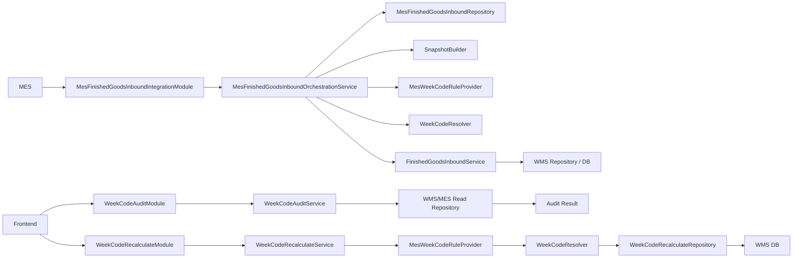

# WMS HTTP API 接口清单（基于当前代码）

> 文档范围：`WMS/Modules` 中当前可发现的 Nancy Module 和 Route；不依据历史需求补写接口。扫描日期：2026-08-26；PDA Phase-1 Runtime 验证结果更新日期：2026-08-26。所有响应 JSON 均为 `ApiResult`：`{ Code, Message, Data }`；Service 内部返回 `OperationResult<T>`（`IsSuccess/Message/Data`），由 Module 转换为 `ApiResult`。

## 接口总览

| # | 业务领域 | 接口名称 | Method | Route | Read/Write | 状态 |
|---|---|---|---|---|---|---|
| 1 | 系统 | Health | GET | `/api/health` | R | ACTIVE |
| 2 | 系统 | Database health | GET | `/api/health/db` | R | ACTIVE |
| 3 | HU | 查询 HU | GET | `/api/wms/hus/{huCode}` | R | ACTIVE |
| 4 | HU | 创建 HU | POST | `/api/wms/hus/` | W | ACTIVE |
| 5 | HU Relation | 建立 HU 包含关系 | POST | `/api/wms/hus/attach` | W | ACTIVE |
| 6 | HU | 新增库存明细 | POST | `/api/wms/hus/{huCode}/items` | W | ACTIVE |
| 7 | HU | 查询 HU 树 | GET | `/api/wms/hus/{huCode}/tree` | R | ACTIVE |
| 8 | Hold / Release | Hold HU | POST | `/api/wms/hus/{huCode}/hold` | W | ACTIVE |
| 9 | Hold / Release | Release HU | POST | `/api/wms/hus/{huCode}/release` | W | ACTIVE |
| 10 | Location / Move | 查询 HU 当前库位 | GET | `/api/wms/hus/{huCode}/location` | R | ACTIVE |
| 11 | Location / Move | 移动 HU | POST | `/api/wms/hus/{huCode}/move` | W | ACTIVE |
| 12 | Location / Move | 查询 HU 移动日志 | GET | `/api/wms/hus/{huCode}/moves` | R | ACTIVE |
| 13 | Location | 查询库位 | GET | `/api/wms/locations/` | R | ACTIVE |
| 14 | Location | 查询单个库位 | GET | `/api/wms/locations/{warehouseCode}/{locationCode}` | R | ACTIVE |
| 15 | Location | 创建库位 | POST | `/api/wms/locations/` | W | ACTIVE |
| 16 | Location | 更新库位 | PUT | `/api/wms/locations/{warehouseCode}/{locationCode}` | W | ACTIVE |
| 17 | 成品入库 | 直接成品入库 | POST | `/api/wms/integration/finished-goods/inbound` | W | ACTIVE |
| 18 | 成品入库与周码治理核心接口 | MES 成品入库 | POST | `/api/wms/integration/finished-goods/mes-inbound` | W | ACTIVE |
| 19 | 上架 | 查询托盘上架状态 | GET | `/api/wms/putaway/pallet/{palletHuCode}` | R | ACTIVE |
| 20 | 上架 | 外箱上架 | POST | `/api/wms/putaway/box` | W | ACTIVE |
| 21 | Repack | 查询外箱状态 | GET | `/api/wms/repack/boxes/{boxHuCode}` | R | ACTIVE |
| 22 | Repack | 内包转箱 | POST | `/api/wms/repack/transfer-inner` | W | ACTIVE |
| 23 | Repack | 内包拆箱至库位 | POST | `/api/wms/repack/unpack-inner` | W | ACTIVE |
| 24 | Repack | 内包装箱 | POST | `/api/wms/repack/pack-inner` | W | ACTIVE |
| 25 | Outbound / Picking | 出库订单列表 | GET | `/api/wms/outbound/orders` | R | ACTIVE |
| 26 | Outbound / Picking | 出库订单详情 | GET | `/api/wms/outbound/orders/{vbeln}` | R | ACTIVE |
| 27 | Outbound / Picking | 分配预览 | POST | `/api/wms/outbound/orders/{vbeln}/preview` | R | ACTIVE |
| 28 | Outbound / Picking | 开始拣货 | POST | `/api/wms/outbound/orders/{vbeln}/start-picking` | W | ACTIVE |
| 29 | Outbound / Picking | 作废订单 | POST | `/api/wms/outbound/orders/{vbeln}/void` | W | ACTIVE |
| 30 | Outbound / Picking | 释放分配 | POST | `/api/wms/outbound/allocations/{allocationNo}/release` | W | ACTIVE |
| 31 | Outbound / Picking | 扫描拣货 | POST | `/api/wms/outbound/pick-batches/{pickBatchNo}/scan` | W | ACTIVE |
| 32 | Outbound / Picking | 发运订单 | POST | `/api/wms/outbound/orders/{vbeln}/ship` | W | ACTIVE |
| 33 | Outbound / Picking | 退回拣货明细 | POST | `/api/wms/outbound/pick-details/{detailId}/return` | W | ACTIVE |
| 34 | Outbound / Picking | RETURNED 回库 | POST | `/api/wms/outbound/returned/{huCode}/putaway` | W | ACTIVE |
| 35 | Outbound / Picking | 预留替换箱 | POST | `/api/wms/outbound/pick-batches/{pickBatchNo}/replace` | W | ACTIVE |
| 36 | Outbound / Picking | FIFO 队列 | GET | `/api/wms/outbound/queue` | R | ACTIVE |
| 37 | Outbound / Picking | FIFO 批次规划 | POST | `/api/wms/outbound/plan` | R | ACTIVE |
| 38 | Outbound / Picking | pick-next 验证入口 | POST | `/api/wms/outbound/pick-next` | - | DEPRECATED |
| 39 | Outbound / Picking | pick-batch 验证入口 | POST | `/api/wms/outbound/pick-batch` | - | DEPRECATED |
| 40 | SAP Integration | 接收 SAP 出库单 | POST | `/api/wms/integration/sap/outbound-orders` | W | ACTIVE |
| 41 | 周码治理核心接口 | 周码审计 | GET | `/api/wms/weekcode/audit` | R | ACTIVE |
| 42 | 周码治理核心接口 | 周码重算 | POST | `/api/wms/weekcode/recalculate` | W | ACTIVE |
| 43 | PDA 库存查询 | 货架 / 外箱 / 内包统一查询 | GET | `/api/wms/inventory/lookup` | R | ACTIVE |
| 44 | 上架 | 扫外箱查询整托上架上下文 | GET | `/api/wms/putaway/pallet/by-box/{boxHuCode}` | R | ACTIVE |
| 45 | 上架 | 整托原子上架 | POST | `/api/wms/putaway/pallet` | W | ACTIVE |
| 46 | Location / Move | 批量原子移库 | POST | `/api/wms/relocation/batch` | W | ACTIVE |
| 47 | Outbound / Picking | 查询当前拣货状态 | GET | `/api/wms/outbound/orders/{vbeln}/picking-state` | R | ACTIVE |
| 48 | Repack | 整箱原子拆包 | POST | `/api/wms/repack/unpack-box` | W | ACTIVE |
| 49 | Repack | 内包原子合箱 | POST | `/api/wms/repack/merge-box` | W | ACTIVE |
| 50 | 上架 | OUTER_BOX TOP 3 推荐货位 | GET | `/api/wms/putaway/recommendations` | R | ACTIVE |

## Project API Conventions

- .NET Framework 4.7.2、Nancy 2.0、SQL Server；仓储实现同时使用 Dapper 与既有 `DbExecutor`。
- Nancy Module 只做 HTTP 适配；Service 负责验证/业务编排；Repository 负责 SQL、连接和事务。MesDb 查询原则上只读，WmsDb 持久化 WMS 状态。
- Service 层以下不得使用 `dynamic`；Nancy 的动态路由/查询参数按 `object` 后再 `Convert.ToString` 转换。
- 除特别标出 HTTP 400 的 Module 外，很多旧 Module 对业务失败只返回 JSON `ApiResult.Code=400`，并未显式设置 HTTP 状态；调用方应同时检查 HTTP 状态和 `Code`。`pick-next`、`pick-batch` 固定返回 `Code=410`。

## 核心调用链



## 通用响应、错误和请求说明

成功示例：
```json
{ "Code": 200, "Message": "success", "Data": {} }
```

业务失败统一形状为 `{ "Code": 400, "Message": "真实 Service 错误文本", "Data": null }`。显式使用 HTTP 400 的接口包括直接入库、MES 入库、PDA 库存查询、周码审计和周码重算；直接入库/MES 入库还会在 JSON 绑定异常时返回 `请求JSON格式或字段类型无效。`，未处理异常返回 500。数据库健康检查的失败 JSON `Code=500`。

下列各接口的 `对应 Service`、请求字段、读写、事务、幂等性与 OperationLog 均以实现为准；“无显式业务事务”不代表底层读操作不存在数据库事务。

## 系统 / Health / Database

### Health — GET `/api/health`

- **对应 Module / Service**：`HealthModule` / 无 Service。
- **用途**：返回 WMS、运行状态、框架版本和本机当前时间。**Request**：无。**数据库影响**：READ ONLY（不访问 DB）。**事务**：无显式业务事务。**幂等**：天然幂等。**OperationLog**：否。
- **Data**：`Service`, `Status`, `Framework`, `Time`；示例：`{ "Code":200, "Message":"success", "Data":{"Service":"WMS","Status":"Running"} }`。
- **常见失败**：代码未定义业务失败分支。

### Database health — GET `/api/health/db`

- **对应 Module / Service**：`HealthModule` / `DbConnectionFactory`。**用途**：打开 WmsDb 并查询服务器、库名、数据库时间。
- **Request**：无；**Data**：`Connected`, `ServerName`, `DatabaseName`, `DatabaseTime`。**数据库影响**：READ ONLY（`@@SERVERNAME`, `DB_NAME()`, `GETDATE()`）。**事务**：无。**幂等**：天然幂等。**OperationLog**：否。
- **常见失败**：`Code=500`，消息为 `数据库连接失败：...`。

## HU、关系、库位、移动、Hold

以下接口均由 `HuModule`、`HuLocationModule` 或 `LocationModule` 暴露；返回 `ApiResult`，成功 `Data` 分别为对应 `HuDto`/`HuItemDto`/`HuTreeNodeDto`/`HuLocationDto`/`HuMoveResultDto`/`HuMoveLogDto[]`/`LocationDto`。除特别说明外，失败为 Service 返回的 `Code=400` JSON。

| 接口（对应 Service） | Request（路径 / Query / Body） | 主要用途与 Response 核心字段 | DB / 事务 / 幂等 / OperationLog |
|---|---|---|---|
| `GET /api/wms/hus/{huCode}` (`HuService.Get`) | path `huCode:string` | 查单个 HU；`Data` 为 HU 编码、类型、状态、来源等。 | R：`WMS_HU`；无显式业务事务；天然幂等；否。 |
| `POST /api/wms/hus/` (`HuService.Create`) | Body `CreateHuRequest`: `HUCode:string`, `HUType:string`, `PlantCode:string`, `SourceSystem:string?`, `SourceEntityId:string?`, `Operator:string`, `RequestId:string?`, `Remark:string?` | 创建 HU，返回 `HuDto`。 | W：`WMS_HU`；Repository 持久化事务；RequestId 幂等（实现按服务/仓储判定）；写 `WMS_HU_OperationLog`（创建）。 |
| `POST /api/wms/hus/attach` (`HuService.Attach`) | Body `AttachHuRequest`: `ParentHuCode:string`, `ChildHuCode:string`, `Operator:string`, `RequestId:string?`, `Remark:string?` | 建立父子 HU 包含关系，`Data:boolean`。 | W：`WMS_HU_Relation`；事务；RequestId 幂等；OperationLog `ATTACH_HU`。 |
| `POST /api/wms/hus/{huCode}/items` (`HuService.AddItem`) | path `huCode`; Body `AddHuItemRequest`: `MaterialCode`, `MaterialRevision?`, `BatchNo?`, `SapBatchNo?`, `ProductionOrderNo?`, `CustomerCode?`, `SalesOrderNo?`, `SalesOrderItem?`, `DateCode?`, `Qty:decimal`, `Uom`, `StockStatus`, `Operator`, `RequestId?`, `Remark?` | 给 HU 添加库存明细，返回 `HuItemDto`（含周码快照字段）。 | W：`WMS_HU_Item`；事务；RequestId 幂等；OperationLog（新增库存）。 |
| `GET /api/wms/hus/{huCode}/tree` (`HuService.GetTree`) | path `huCode` | 返回 HU 递归树。 | R：`WMS_HU`,`WMS_HU_Relation`,`WMS_HU_Item`；无；天然幂等；否。 |
| `POST /api/wms/hus/{huCode}/hold` (`HuHoldService.Hold`) | path `huCode`; Body `HoldHuRequest`: `HoldType`, `HoldReasonCode`, `HoldReason?`, `Operator`, `RequestId?` | 对 HU 创建 active hold，返回 `HuHoldResultDto`。 | W：`WMS_HU`,`WMS_HU_HoldLog`；事务；RequestId 幂等；OperationLog `HU_HOLD`。 |
| `POST /api/wms/hus/{huCode}/release` (`HuHoldService.Release`) | path `huCode`; Body `ReleaseHuRequest`: `ReleaseReason?`, `Operator`, `RequestId?` | 释放 active hold，返回 `HuHoldResultDto`。 | W：`WMS_HU`,`WMS_HU_HoldLog`；事务；RequestId 幂等；OperationLog `HU_RELEASE`。 |
| `GET /api/wms/hus/{huCode}/location` (`HuLocationService.GetLocation`) | path `huCode` | 同时返回 DirectLocation 与最近 active parent fallback 的 EffectiveLocation；`LocationSourceHuCode/LocationSourceHuType/LocationSource/IsInherited` 表示实际来源，不会以有效库位覆盖直接库位字段。 | R：`WMS_HU_CurrentLocation`,`WMS_HU_Relation`,`WMS_HU`,`WMS_Location`；无；天然幂等；否。 |
| `POST /api/wms/hus/{huCode}/move` (`HuLocationService.Move`) | path `huCode`; Body `HuMoveRequest`: `ToLocationCode`, `ExpectedFromLocationCode?`, `MoveType`, `ScannedLocationCode?`, `BusinessNo?`, `TaskNo?`, `RequestId?`, `ReasonCode?`, `Operator`, `Remark?` | 移动 HU，返回 `OperationNo`, `MoveLogId`, From/To Location, `IsDuplicate` 等。 | W：`WMS_HU_CurrentLocation`,`WMS_HU_MoveLog`; 事务；RequestId 幂等；OperationLog（移动）。 |
| `GET /api/wms/hus/{huCode}/moves` (`HuLocationService.GetMoveLogs`) | path `huCode`; query `top:int`，默认 50，非整数仍使用 50 | 返回最近移动日志数组。 | R：`WMS_HU_MoveLog`；无；天然幂等；否。 |
| `GET /api/wms/locations/` (`LocationService.GetList`) | query `warehouseCode:string?`, `zoneCode:string?` | 查询库位列表。 | R：`WMS_Location`；无；天然幂等；否。 |
| `GET /api/wms/locations/{warehouseCode}/{locationCode}` (`LocationService.Get`) | 两个 path 字符串 | 查询单库位。 | R：`WMS_Location`；无；天然幂等；否。 |
| `POST /api/wms/locations/` (`LocationService.Create`) | Body `CreateLocationRequest`: `WarehouseCode`, `LocationCode`, `LocationName?`, `LocationType`, `ZoneCode?`, `IsVirtual:bool`, `Operator` | 创建库位，返回 `LocationDto`。 | W：`WMS_Location`；事务；非幂等（DTO 无 RequestId）；否。 |
| `PUT /api/wms/locations/{warehouseCode}/{locationCode}` (`LocationService.Update`) | path；Body `UpdateLocationRequest`: `LocationName?`, `LocationType?`, `ZoneCode?`, `MasterStatus?`, `IsVirtual:bool?`, `Operator` | 更新库位，返回 `LocationDto`。 | W：`WMS_Location`；事务；非幂等；否。 |

## PDA Inventory Lookup

### 货架 / 外箱 / 内包统一查询 — GET `/api/wms/inventory/lookup`

- **对应 Module / Service**：`InventoryQueryModule` / `InventoryQueryService`。
- **Request**：query `warehouseCode:string`（必填，最大 30）与 `code:string`（必填，最大 200）；两者 Trim 后查询。解析顺序为请求仓库内 Location → HUCode → active HU Identifier。
- **LOCATION Data**：`QueryCode`,`ResultType=LOCATION`,`WarehouseCode`,`ZoneCode`,`LocationCode`,`Items[]`；每个 Item 为一个 ACTIVE OUTER_BOX，含 `BoxCode`,`MaterialCode`,`MaterialRevision`,`WeekDisplay`,`Qty`,`PackCount`,`Status`,`IsHold`。Held 箱保留，SHIPPED 不作为货架库存，按 BoxCode 升序。
- **OUTER_BOX Data**：返回 canonical `BoxCode`、`HuStatus`,`IsHold`、物料/版本、有效库位、`LocationSource` 和按 Pack/Batch/Week 聚合的 `Items[]`。
- **INNER_PACK Data**：返回 `PackCode`,`ParentBoxCode`,`HuStatus`,`IsHold`、物料/版本/批次/周码、`TotalQty`，`Items=[]`。多条 active Item 仅在物料、版本、批次、周码一致时汇总；冲突返回 `INNER_PACK_ITEM_CONFLICT:` 开头的 HTTP/API 400 Message。
- **EffectiveLocation**：Location 清单与 HU 查询共用 resolver；顺序为 SELF → 最近 active parent。`LocationSource` 为 `SELF`,`PARENT_BOX`,`PARENT_PALLET` 或空。外箱无直接库位但父托盘位于目标货架时仍属于该货架库存。
- **仓库边界**：HU 有有效库位但不属于请求仓库时返回业务失败；无有效库位仍返回 HU 且库位字段为空。非 ACTIVE HU 可查询事实，但 SHIPPED Location 不作为物理库位返回。
- **数据库影响**：READ ONLY：`WMS_Warehouse`,`WMS_Zone`,`WMS_Location`,`WMS_HU`,`WMS_HU_Identifier`,`WMS_HU_Relation`,`WMS_HU_Item`,`WMS_HU_CurrentLocation`。无事务、无 OperationLog、天然幂等，不访问 MES。

## Finished Goods Inbound

### 直接成品入库 — POST `/api/wms/integration/finished-goods/inbound`

- **对应 Module / Service**：`FinishedGoodsInboundIntegrationModule` / `FinishedGoodsInboundService`。
- **用途**：接收调用方提供的完整成品快照；结构校验后解析每个内包的周码并持久化 HU 层级。
- **Request Body**：`FinishedGoodsInboundReceiveRequest`：`Snapshot`（必填）、`RequestId:string?`（最多 100）、`Operator:string`（必填，最多 50）、`Remark:string?`（最多 1000）。`Snapshot`：`SourceSystem`, `SourceType`, `SourceEntityId`, `SourceReferenceNo?`, `PlantCode`, `Pallet?`（`SourceEntityId`,`PalletCode`），`Boxes[]`（`SourceEntityId`,`BoxCode`,`AlternateBoxCode?`,`MaterialCode`,`MaterialRevision?`,`Uom`,`WeekRuleSource?`,`WeekRuleValue?`,`InnerPacks[]`）；每个 pack：`SourceEntityId`,`PackId?`,`PackCode`,`IsSpecialSapCharg`,`Qty:decimal`,`DateCode?`,`PackCreatedTime?`。`PackId` 是 MES `PK_Packmaster.PackID` 源事实；MES canonical ingress 会从 `PK_PackLot → PP_LotCard.OrderType` 派生特殊分类，并将一个或多个有效 `PK_PackLot.LotNo` 去重后按最小 `LotSeq ASC, LotNo ASC` 排序，以英文逗号无空格拼接写入 `WMS_FG_HU_Item.LotNo`（最多 500 字符）。通用接口客户端提交的 `LotNo`、`SapBatchNo`、`WeekCode` 和解析状态均不作为权威值。
- **示例**：`POST {{localUrl}}/api/wms/integration/finished-goods/inbound`，Body：`{"RequestId":"FGI-001","Operator":"MES","Snapshot":{"SourceSystem":"MES","SourceType":"PlanStock","SourceEntityId":"PS-1","PlantCode":"P1","Boxes":[{"SourceEntityId":"B-1","BoxCode":"BOX-1","MaterialCode":"MAT-1","Uom":"PCS","InnerPacks":[{"SourceEntityId":"PK-1","PackCode":"PACK-1","Qty":10,"DateCode":"2401"}]}]}}`。
- **Response**：`Data` 为 `ReceiptId`, `SourceSystem`, `SourceType`, `SourceEntityId`, `SnapshotHash`, `HashVersion`, `ReceiveTime`, `IsDuplicate`；例如 `{"Code":200,"Message":"SUCCESS","Data":{"ReceiptId":1,"IsDuplicate":false}}`。
- **常见失败**：HTTP/Code 400：请求为空、`Operator`/快照必填项无效、结构校验失败、同一来源存在不同 `SnapshotHash` 或版本；绑定异常 400；未捕获异常 500。
- **数据库影响**：WRITE：`WMS_FinishedGoodsInboundReceipt`,`WMS_HU`,`WMS_HU_Relation`,`WMS_HU_Item`,`WMS_HU_CurrentLocation`,`WMS_HU_MoveLog`,`WMS_HU_OperationLog`，必要时 `WMS_HU_Identifier`,`WMS_HU_HoldLog`；读取 `WMS_Location`,`WMS_WarehousePlant`。
- **事务 / 幂等 / OperationLog**：一份 source snapshot 的全量持久化使用一个 Serializable 事务；以 `SourceSystem + SourceType + SourceEntityId + SnapshotHash + HashVersion` 实现 SnapshotHash 幂等，hash 不同为冲突。写 `RECEIVE`,`CREATE_HU`,`ATTACH_HU`，周码异常还写 `HU_HOLD`。

### 【成品入库与周码治理核心接口】MES 成品入库 — POST `/api/wms/integration/finished-goods/mes-inbound`

- **对应 Module / Service**：`MesFinishedGoodsInboundIntegrationModule` / `MesFinishedGoodsInboundOrchestrationService` → `FinishedGoodsInboundService`。
- **用途**：只接收 MES `PlanStockId`，从 MES 构建真实源图并再调用上述入库服务。MES Repository 读取 `PK_PlanStock`、`PK_Box`、`PK_Packmaster`；周码规则 Provider 读取 `MD_Flow`、`MD_FlowStation`、`MD_StationAttValue`。最终层级为 `PALLET → OUTER_BOX → INNER_PACK`。
- **Request**：Body `MesFinishedGoodsInboundTriggerRequest`：`PlanStockId:string`（必填）。示例：`POST {{localUrl}}/api/wms/integration/finished-goods/mes-inbound`，`{"PlanStockId":"PS-1"}`。
- **Response**：`Data` 为 `PlanStockId`, `ReceiptId:long`, `IsDuplicate:bool`；示例 `{"Code":200,"Message":"success","Data":{"PlanStockId":"PS-1","ReceiptId":1,"IsDuplicate":false}}`。
- **常见失败**：HTTP/Code 400：`planStockId不能为空。`、MES 源图/快照构建失败、规则查找或入库验证失败；JSON 绑定错误 400；未捕获异常 500。
- **周码异常规则**：周码无法解析不会阻止物理 Receive；对应 OUTER_BOX 以 `WEEKCODE_UNRESOLVED` active Hold 持久化，内包 WeekCode 派生列为空。该行为发生在同一入库事务内。
- **数据库影响**：MES DB 只读上述源/规则表；WMS 写入与“直接成品入库”相同。**事务**：MES 读取不与 WMS 合并事务；WMS 收货为单个 Serializable 事务。**幂等**：最终以 source snapshot 的 SnapshotHash 语义处理。**OperationLog**：同直接成品入库。
- **Runtime Verification**：已从 Module、Service、Repository 和 Tests 源码核对调用/持久化逻辑；本任务未执行 POST、数据库或 Runtime 验证，需参考人工 Runtime Test 记录。

## Putaway / Repack

| 接口（对应 Service） | Request | 用途 / Response | DB、事务、幂等、OperationLog |
|---|---|---|---|
| `GET /api/wms/putaway/pallet/{palletHuCode}` (`PutawayService.GetPalletStatus`) | path `palletHuCode` | 扫托盘，返回 `PalletPutawayStatusDto`。 | R：HU、Relation、Location/CurrentLocation；无；天然幂等；否。 |
| `GET /api/wms/putaway/pallet/by-box/{boxHuCode}` (`PutawayService.GetPalletContextByBox`) | path `boxHuCode` | 由 active OUTER_BOX 反查运输托，返回托盘有效库位、仓库、箱数/总数量和当前 active child boxes 的物料、版本、周、Hold、状态、EffectiveLocation。 | R：HU、Relation、Item、CurrentLocation；无；天然幂等；否。 |
| `GET /api/wms/putaway/recommendations` (`PutawayRecommendationService.GetRecommendations`) | query `warehouseCode`（必填/最大30）、`boxHuCode`（必填/最大100）、`itMode`（可选，默认 false） | 为 RECEIVE 中的 ACTIVE、非 Hold OUTER_BOX 尽量返回最多 3 个不同位置的 `V1.1.1_DYNAMIC_CLUSTER` 决策辅助候选。`Reason` 始终为操作员简短文案；仅 `itMode=true` 时返回 `ITReason` 诊断。 | 严格只读：读取 HU/Relation/Item/CurrentLocation、WarehousePlant、Location/Zone 和物理拓扑；无事务写入、无 reservation/MoveLog/OperationLog，天然幂等但库存变化可导致排序变化。 |
| `POST /api/wms/putaway/box` (`PutawayService.PutawayBox`) | `PutawayBoxRequest`: `BoxHuCode`,`WarehouseCode`,`ToLocationCode`,`ScannedLocationCode?`,`RequestId`,`BusinessNo?`,`Operator`,`Remark?`；不接受 SourceMode | 通用外箱上架；后端从 active parent/direct location 派生 `PALLET_INHERITED` 或 `DIRECT_RECEIVE`。`Data` 向后兼容增加 `SourceMode`，其余保留 OperationNo、MoveLogId、PalletHuCode、From/To、RemainingBoxCount、IsPalletEmpty/Closed、IsDuplicate。 | 两种模式均为原子事务和 RequestId 幂等。PALLET_INHERITED 保留 Relation detach、Box CurrentLocation、剩余箱数/关托及 DETACH_HU/PUTAWAY；DIRECT_RECEIVE 仅允许无父级、SELF/active RECEIVE 的 ACTIVE 非 Hold OUTER_BOX，直接移动到同仓 physical STORAGE，只更新外箱 CurrentLocation并写 PUTAWAY，不创建/解绑 PALLET，也不更新 child INNER_PACK。 |
| `POST /api/wms/putaway/pallet` (`PutawayService.PutawayPallet`) | `WholePalletPutawayRequest`: `PalletHuCode`,`WarehouseCode`,`TargetLocationCode`,`ScannedLocationCode?`,`RequestId`,`BusinessNo?`,`Operator`,`Remark?` | 当前托盘全部 active OUTER_BOX 一次原子拆托上架；返回 Pallet、From/To、BoxCodes、MovedCount、IsPalletClosed、IsDuplicate。 | W：HU、Relation、CurrentLocation、MoveLog、OperationLog；单个 Serializable 事务，事务内重载托盘/箱/货位/Hold/厂别；base RequestId 判重，子 MoveLog 使用确定性后缀；`PUTAWAY_PALLET`,`DETACH_HU`,`PUTAWAY`,`CLOSE_HU`。任一箱失败整体回滚。 |
| `GET /api/wms/repack/boxes/{boxHuCode}` (`RepackService.GetBoxStatus`) | path `boxHuCode` | 查询外箱及内包状态。 | R：HU、Relation、Item、Location；无；天然幂等；否。 |
| `POST /api/wms/repack/transfer-inner` (`RepackService.TransferInner`) | `TransferInnerRequest`: `SourceBoxHuCode`,`TargetBoxHuCode`,`InnerHuCode`,`RequestId`,`BusinessNo?`,`Operator`,`Remark?` | 将内包在两个外箱间转移。 | W：Relation、MoveLog、OperationLog；事务；RequestId 幂等；`REPACK_TRANSFER`。 |
| `POST /api/wms/repack/unpack-inner` (`RepackService.UnpackInner`) | `UnpackInnerRequest`: `SourceBoxHuCode`,`InnerHuCode`,`WarehouseCode`,`ToLocationCode`,`ScannedLocationCode?`,`RequestId`,`BusinessNo?`,`Operator`,`Remark?` | 内包从箱拆到库位。 | W：Relation、CurrentLocation、MoveLog、OperationLog；事务；RequestId 幂等；`REPACK_UNPACK`。 |
| `POST /api/wms/repack/unpack-box` (`RepackService.UnpackBox`) | `UnpackBoxRequest`: `BoxHuCode`,`WarehouseCode`,`ToLocationCode?`,`ScannedLocationCode?`,`RequestId`,`BusinessNo?`,`Operator`,`Remark?` | 将外箱全部 active INNER_PACK 一次原子解绑；未传 ToLocationCode 时使用源箱当前直接 STORAGE 货位；返回 InnerPackCodes/UnpackedCount。 | W：Relation、CurrentLocation、MoveLog、OperationLog；单个 Serializable 事务；复用 unpack-inner 的“解绑并给内包建立实体 STORAGE 直接库位”语义；base RequestId 判重，子 MoveLog 使用确定性后缀；任一子项失败整体回滚。 |
| `POST /api/wms/repack/merge-box` (`RepackService.MergeBox`) | `MergeBoxRequest`: `WarehouseCode`,`InnerPackHuCodes[]`,`RequestId`,`BusinessNo?`,`Operator`,`Remark?`；不接收新箱码、厂别、序号或目标库位 | 将不同 STORAGE 货架的 detached INNER_PACK 原子合并为新 OUTER_BOX；返回 `NewBoxHuCode`,`PlantCode`,`WarehouseCode`,`MaterialCode`,`MaterialRevision`,`InnerPackCount`,`TotalQty`,`InnerPackHuCodes`,`LocationCode`,`ZoneCode`,`IsDuplicate`。箱码由后端按 `B{YYMMDD}{NNNN}{PlantSuffix}` 生成，1010=A、1020=B。 | W：BoxCodeSequence、HU、Relation、CurrentLocation、MoveLog、OperationLog；单个 Serializable 事务，`UPDLOCK/HOLDLOCK` 序列分配；同厂/仓/物料/版本，Batch/Week/源货架可不同；新箱 ACTIVE/INBOUND-PENDING，内包 DirectLocation 清空并从 PARENT_BOX 继承 EffectiveLocation；RequestId 快照幂等，重放不消耗新序号。 |
| `POST /api/wms/repack/pack-inner` (`RepackService.PackInner`) | `PackInnerRequest`: `TargetBoxHuCode`,`InnerHuCode`,`RequestId`,`BusinessNo?`,`Operator`,`Remark?` | 将库位内包加入外箱。 | W：Relation、CurrentLocation、MoveLog、OperationLog；事务；RequestId 幂等；`REPACK_PACK`。 |

所有表中成功响应均为 `ApiResult.Success(Data, Message)`；失败为 Service 的 `ApiResult.Fail(Message)`。请求示例格式：`POST {{localUrl}}/api/wms/putaway/box`，JSON 按 Request 字段填入有效 HU/库位；其余路径同总览。

外箱上架来源模式完全由后端当前事实决定：active PALLET parent + box 无 DirectLocation + 有效位置继承 PALLET 为 `PALLET_INHERITED`；无 active parent + box SELF DirectLocation 位于有效 RECEIVE 为 `DIRECT_RECEIVE`。无父级 SELF/STORAGE 明确拒绝并提示使用移库。Merge Box 创建的 `ACTIVE / SELF / INBOUND-PENDING / RECEIVE` 新箱可直接走同一路由到 STORAGE；其 child INNER_PACK 不建立直接库位，继续通过 `PARENT_BOX` 继承新货架。推荐上架 PDA 不发送 SourceMode，并为同一 Box+Target 网络重试保留同一 RequestId。

推荐算法固定为 `V1.1.1_DYNAMIC_CLUSTER` / `DECISION_ASSISTANCE` / TOP 3，主维度为 `PlantCode + MaterialCode + MaterialRevision`。真实已占用主簇少于 3 个 Location 时不推断容量，但可在现有簇位之后加入 `OPERATION_BACKUP` 空位以补足现场候选；Backup 不计入 `ClusterLocationCount`，不改变 `INSUFFICIENT_SAMPLE/FILL_REQUIRED`，也不复用 `CLUSTER_EXPANSION`。达到至少 3 个真实簇位后仍先补不平衡位置，只有当前平衡时才允许 `POSSIBLY_FULL -> CLUSTER_EXPANSION`。`CurrentBoxCount` 是当前 Location 内精确匹配厂别、料号和版本的 OUTER_BOX 数量。IT mode 只控制诊断字段，不改变候选、Rank、Level 或推断。

物理连续性只使用 `WMS_Location.PhysicalRackGroupCode + PhysicalRowCode + PositionSequence`；不解析 LocationCode/Remark，不复用 RouteSequence，也不创建 LocationAdjacency。迁移草案为 `docs/database/017_LocationPhysicalTopology.sql`，包含确认的 H1–H9 拓扑（H913 有效且不虚构 H813），本轮未对 WMS_DEV 执行。推荐不分配、不预留、不自动上架；PDA 必须继续扫描实际 STORAGE 货位，实际扫描值仍由现有 `POST /api/wms/putaway/box` 事务重新校验并作为权威事实，选择非 TOP1 的合法货位不会因推荐不一致而失败。

## Outbound / Picking

**对应 Module**：均为 `OutboundModule`；正式订单接口使用 `FormalOutboundService`，`queue`/`plan` 使用 `OutboundService`。正式预览只读，不创建 Reservation 或变更状态。

正式出库状态机为 `WAIT_PICK → ALLOCATED → PICKING → PICKED → SHIPPED`。PDA Picking Resume 对 `ALLOCATED` 和 `PICKING` 均适用：`ALLOCATED` 恢复已分配但尚未发生首个实体扫描的任务，`PICKING` 恢复首个实体扫描后的在途任务；Resume 只读取并返回既有 Allocation、PickBatch、Reservation 和 PickDetail，不创建新的拣货事实。

| 接口 | Request | Data 核心字段 | DB / 事务 / 幂等 / OperationLog |
|---|---|---|---|
| `GET /orders` | query 经 `OutboundOrderQuery` 绑定（`OrderStatus?`,`PlantCode?`,`WarehouseCode?`,`Top:int`） | `OutboundOrderDto[]`（订单与 Lines） | R：OutboundOrder/Line；无；天然幂等；否。 |
| `GET /orders/{vbeln}` | path `vbeln` | `OutboundOrderDto` | R：OutboundOrder/Line；无；天然幂等；否。 |
| `GET /orders/{vbeln}/picking-state` | path `vbeln` | `OutboundPickingStateDto`：订单/Lines、选定 Allocation、PickBatches、active Reservations 对应 RemainingTasks、已落库 PickDetails、完成标记 | R：OutboundOrder/Line、Allocation、Reservation、PickBatch/PickDetail、HU、Location；严格只读；不调用 StartPicking、不创建或更新任何拣货事实。WAIT_PICK 不伪造批次；ALLOCATED 与 PICKING 均恢复既有任务；同一订单多个 active Allocation 或同一 GroupKey 多个 active PickBatch 返回 `PICKING_STATE_CONFLICT:`。 |
| `POST /orders/{vbeln}/preview` | path `vbeln`；无 Body | `OutboundPreviewDto`、分组 Allocation Plan | R：订单、HU/Item/Location；无；天然幂等；否。 |
| `POST /orders/{vbeln}/start-picking` | `StartPickingRequest`: `RequestId`,`Operator`,`Remark?` | AllocationNo、Status、ExpireTime、Batches/Reservations、IsDuplicate | W：订单、Allocation、Reservation、PickBatch、OperationLog；整张 delivery 在事务中分配；RequestId 幂等；开始分配日志。 |
| `POST /orders/{vbeln}/void` | `OutboundActionRequest`: `RequestId`,`Operator`,`Reason?` | `BusinessNo`,`Status`,`IsDuplicate` | W：OutboundOrder/Allocation/Reservation；事务；RequestId 幂等；动作日志。 |
| `POST /allocations/{allocationNo}/release` | 同 `OutboundActionRequest` | `BusinessNo`,`Status`,`IsDuplicate` | W：Allocation/Reservation；事务；RequestId 幂等；动作日志。 |
| `POST /pick-batches/{pickBatchNo}/scan` | `OutboundScanRequest`: `HuCodeOrIdentifier`,`RequestId`,`Operator`,`Remark?` | PickDetailId、Box、From/To、Qty、Batch/OrderStatus、MoveLogId、IsDuplicate | W：PickDetail、PickBatch、Order、CurrentLocation、MoveLog、OperationLog；单次扫描事务；RequestId 幂等；拣货/移动日志。 |
| `POST /orders/{vbeln}/ship` | `ShipOutboundRequest`: `RequestId`,`Operator`,`Remark?` | typed shipping state | **DEPRECATED_ALIAS**：委托 `confirm-shipment`；仅 SAP 明确成功或 IT 人工确认成功后执行 Shipment Finalizer，不再直接出货。 |
| `POST /pick-details/{detailId}/return` | `detailId:long`；`ReturnPickDetailRequest`: `RequestId`,`Operator`,`ExceptionType`,`ReasonCode?`,`Reason?`,`Remark?` | `BusinessNo`,`Status`,`IsDuplicate` | W：PickDetail、Exception、HU Hold/Location；事务；RequestId 幂等；退货异常日志。非法 detailId 立即返回 `Code=400`。 |
| `POST /returned/{huCode}/putaway` | path `huCode`；`ReturnToStockRequest`: `ToLocationCode`,`RequestId`,`Operator`,`Remark?` | `BusinessNo`,`Status`,`IsDuplicate` | W：CurrentLocation、MoveLog、PickDetail；事务；RequestId 幂等；回库日志。 |
| `POST /pick-batches/{pickBatchNo}/replace` | `ReplacementRequest`: `ExceptionNo`,`RequestId`,`Operator`,`Remark?` | `StartPickingResultDto` | W：Reservation/PickDetail/Exception；事务；RequestId 幂等；替换日志。 |
| `GET /queue` | query `OutboundQueueQuery`（`PlantCode?`,`MaterialCode?`,`MaterialRevision?`,`Top:int`，<=0 时 Module 默认 20） | `OutboundQueueItemDto[]` | R：HU/Item/Location；无；天然幂等；否。 |
| `POST /plan` | `OutboundBatchPlanRequest`: `PlantCode`,`MaterialCode`,`MaterialRevision?`,`RequiredQty:decimal`,`Uom?` | `OutboundBatchPlanDto` | R：HU/Item/Location；无；天然幂等；否。 |
| `POST /pick-next` | 无 | 固定失败 | 不访问 DB；无；不适用；否；固定 `Code=410`，提示使用 StartPicking/Scan。 |
| `POST /pick-batch` | 无 | 固定失败 | 不访问 DB；无；不适用；否；固定 `Code=410`，提示使用 StartPicking/Scan。 |

请求示例：`POST {{localUrl}}/api/wms/outbound/orders/80000001/start-picking`，Body `{"RequestId":"PICK-1","Operator":"OP01","Remark":""}`；所有正式接口成功 JSON 均遵循通用包络。

## Relocation

| 接口 | Request | Data 核心字段 | DB / 事务 / 幂等 / OperationLog |
|---|---|---|---|
| `POST /api/wms/relocation/batch` | `BatchRelocationRequest`: `WarehouseCode`,`SourceLocationCode`,`TargetLocationCode`,`BoxHuCodes[]`,`RequestId`,`Operator`,`Reason?`,`Remark?` | Source/Target、BoxCodes、MovedCount、OperationNo、IsDuplicate、MoveTime | 仅 OUTER_BOX；去重输入；源/目标必须是指定仓库 active physical STORAGE；箱必须 ACTIVE、非 Hold、无 active parent，事务内有效源位置等于 Source；单个 Serializable 事务，集合锁定/验证并写 CurrentLocation、MoveLog、OperationLog；base RequestId 判重，子 MoveLog 使用确定性后缀；无 partial success。 |

## PDA Phase-1 Runtime Verification — 2026-08-26

- `RUNTIME_MUTATION_TESTS_EXECUTED=True`。本轮由 Human Review 使用 Postman 在 `WMS_DEV` 执行了真实 WMS 写入；环境为 .NET Framework 4.7.2、Nancy 2.0、SQL Server，`WarehouseCode=FG01`、`PlantCode=1010`、Storage Location 为 `H201` / `H305`，Inbound virtual location 为 `INBOUND-PENDING`。
- Whole Pallet Putaway：`GET /api/wms/putaway/pallet/by-box/{boxHuCode}` 与 `POST /api/wms/putaway/pallet` 已 Runtime Verified。样本为 1 个 PALLET、3 个 OUTER_BOX、4 个 INNER_PACK；箱数量分别为 40、30、30 PCS，总计 100 PCS，`Material=14A890336C`、`Revision=41`。
- Batch Relocation：`POST /api/wms/relocation/batch` 已 Runtime Verified。
- PDA Picking Resume：`GET /api/wms/outbound/orders/{vbeln}/picking-state` 已 Runtime Verified；`ALLOCATED` 与 `PICKING` 两种状态均适用 Resume，且不改变既有公共 Contract。
- Whole-box Unpack：`POST /api/wms/repack/unpack-box` 已 Runtime Verified。
- `UNPACK_LOCATION_SEMANTICS_UNCLEAR=False`：现有 unpack-inner 明确关闭 active Relation，并给拆出的 INNER_PACK 建立实体 STORAGE DirectLocation；whole-box command 复用同一语义，此项不是 Known Gap。
- 本轮仅验证 `WMS_DEV`，未在 Production 执行；未调用最终 `SHIP`，未执行推荐上架、Merge Box Runtime 或 Label Print。Merge Box 后端现已实现，但迁移和 Runtime POST 尚未执行。状态机末态 `SHIPPED` 是正式公共 Contract，不表示本轮已执行 SHIP Runtime 测试。

## PDA Phase-1 Known Gaps

- `RECOMMENDED_PUTAWAY_RULE_UNDEFINED=False`：已由 `V1.1.1_DYNAMIC_CLUSTER` Operator/IT 双模式 TOP 3 只读决策辅助闭环；少于 3 个真实簇位仍不推断容量，仍待 Runtime GET 场景验证。
- `NEW_OUTER_BOX_CODE_OWNERSHIP_UNCLEAR=False`：合箱新 OUTER_BOX 箱码由 WMS Backend 在正式事务中生成；格式 `B{YYMMDD}{NNNN}{PlantSuffix}`，厂别 1010=A、1020=B，序列范围 `BusinessDate + PlantCode`。迁移草案 `016_MergeBoxCodeSequence.sql` 新增最小序列表，尚未执行。
- `MERGE_BOX_LOCATION_SEMANTICS_UNCLEAR=False`：新箱为 ACTIVE 且 DirectLocation=`INBOUND-PENDING`/Zone=`RECEIVE`；子 INNER_PACK 的直接 STORAGE 库位清空，active parent 指向新箱，EffectiveLocation/LocationSource 由现有 resolver 返回 `INBOUND-PENDING`/`PARENT_BOX`。跨 STORAGE 货架合箱允许。
- `LABEL_PRINT_INTEGRATION_PENDING`：未找到正式箱标签打印 API、打印机协议或服务；未新增打印基础设施。

## SAP Integration

### 接收 SAP 出库单 — POST `/api/wms/integration/sap/outbound-orders`

- **对应 Module / Service**：`SapOutboundIntegrationModule` / `SapOutboundOrderReceiveService`。
- **Request**：原始 JSON Body（Module 直接读取 `Request.Body`，不使用 `Bind<T>`）；结构由 SAP 接收服务的 `SapOutboundOrderReceive...` 模型解析。
- **用途 / Response**：将 SAP 出库单转换为 WMS 的 WAIT_PICK 订单；`Data` 为 `SapOutboundOrderReceiveResultDto`。示例 URL：`POST {{localUrl}}/api/wms/integration/sap/outbound-orders`。
- **数据库影响 / 事务 / 幂等 / Log**：WRITE：`WMS_OutboundOrder`,`WMS_OutboundOrderLine` 及接收日志相关表；Repository 事务；服务按其 SAP 请求标识/规范化内容判重；OperationLog 以实现为准。
- **常见失败**：Service 失败消息包装为 `Code=400`（Module 未显式设置 HTTP 400）。

### SAP Outbound Posting V1

| 接口 | 用途与约束 |
|---|---|
| `GET /api/wms/outbound/orders/{vbeln}/sap-posting-preview` | 严格只读；使用与正式发送相同的 builder 返回完整 `data[]`、PayloadJson/Hash、行/箱/数量合计；不建 snapshot/attempt，不调用 SAP。 |
| `GET /api/wms/outbound/orders/{vbeln}/shipping-state` | 返回 OutboundStatus、SapPostingStatus、PickedBoxCount/Qty、LastSapCode/Message、CanConfirmShipment、CanRetry、RequiresITReview。 |
| `POST /api/wms/outbound/orders/{vbeln}/confirm-shipment` | Body 仅 `RequestId`,`Operator`,`Remark?`；后端冻结 VBELN 全量快照并一次调用 S0089。SAP S 才 SHIPPED；E 保持 PICKED/FAILED；可能已到 SAP 但结果未知时为 UNKNOWN。 |
| `POST /api/wms/outbound/orders/{vbeln}/ship` | **DEPRECATED_ALIAS**；请求兼容旧 ShipOutboundRequest，但委托 confirm-shipment，不再允许直接 PICKED→SHIPPED。 |
| `POST /api/wms/outbound/orders/{vbeln}/sap-posting/manual-confirm-posted` | Body 必须包含 `RequestId`,`Operator`,`Remark`,`ExpectedIntegrationLogId`。仅订单仍为 PICKED、Posting/所选最新日志均为 UNKNOWN 且 HTTP 非 401/403 时允许；不调用 SAP，追加 `MANUAL_CONFIRMED_POSTED/SUCCESS` 审计事件，并在同一 Serializable 事务中复用 Shipment Finalizer 转 SUCCESS/SHIPPED。 |
| `POST /api/wms/outbound/orders/{vbeln}/sap-posting/manual-confirm-not-posted` | Body 同上且 Remark 必填；满足相同最新 UNKNOWN 约束时不调用 SAP，保留原 UNKNOWN 日志并追加 `MANUAL_CONFIRMED_NOT_POSTED/FAILED` 审计事件，只将 Posting 转为 retry-eligible FAILED，订单/HU 仍保持 PICKED。 |
| `POST /api/wms/outbound/orders/{vbeln}/sap-posting/retry` | Body 必须包含 `RequestId`,`Operator`,`Remark`,`ExpectedIntegrationLogId`。FAILED 可使用新 RequestId 重试；兼容历史误分类时，仅允许当前最新 Attempt/IntegrationLog 为 HTTP 401/403 的 UNKNOWN 使用新 RequestId 重试。两种情况均复用原 Posting/Detail/PayloadJson/PayloadHash 并创建新 attempt；其他 UNKNOWN 禁止盲目重试。 |
| `GET /api/wms/outbound/shipping-orders` | 出货管理分页查询，支持 SAPDeliveryNo、OutboundStatus、PostingStatus。 |
| `GET /api/wms/integration/sap/logs` / `logs/{id}` | 通用 SAP 通信日志列表/详情；列表不返回大 JSON，详情返回 Request/Response、异常与 PayloadHash。 |

Learun WMS_FG 出货管理页面复用同一 SAP Posting Service，并使用页面专用只读 contract：

| 接口 | 用途与约束 |
|---|---|
| `GET /api/wms-fg/outbound/shipment-management/orders` | 服务端过滤、汇总、分页。Query：`dateFrom`,`dateTo`,`sapDeliveryNo`,`customerCode`,`materialCode`,`plantCode`,`warehouseCode`,`sapPostingStatus`,`businessStatus`,`page`,`pageSize`。返回 `summary`（完整过滤范围）及分页 `items`；页面字段固定 camelCase `sapDeliveryNo`、`sapPostingStatus`。 |
| `GET /api/wms-fg/outbound/orders/{vbeln}/shipment-detail` | 一次返回 `deliveryLines`,`pickedBoxes`,`posting`。一个 OUTER_BOX 一个父 DTO；子项来自冻结 PickDetailItem，字段使用 `sapItemNo`,`sapBatchNo`。来源库位取冻结 Pick MoveLog 的 FromLocation。 |
| `POST /api/wms-fg/outbound/orders/{vbeln}/confirm-shipment` | PC 与 PDA 复用既有 ConfirmShipment；FAILED/UNKNOWN 不在出货管理页提供 retry/manual recovery。 |
| `GET /api/wms-fg/integration/sap/logs` / `logs/{id}` | SAP 技术日志及 FAILED/UNKNOWN 恢复边界；出货管理页只带 `businessKey=sapDeliveryNo` 跳转查看。 |

SAP字段固定：聚合=`VBELN`；`POSNR=OutboundOrderLine.SAPItemNo`；`MATNR=OutboundOrderLine.MaterialCode` 且校验 PickDetailItem 物料；`LGORT=OutboundOrderLine.SAPStorageLocation`；`BOXNO=canonical WMS_HU.HUCode`；`CHARG=PickDetailItem.SAPBatchNo`，禁止 BatchNo fallback。LFIMG 按 PickDetail+Line+SAPBatchNo 求和；LFIMG_BOX 等于当前 BOXNO+POSNR+CHARG 行的 LFIMG。所有 Payload 行按 BOXNO 汇总后仍必须等于对应 PickBatchDetail.EffectiveQty。LFIMG/LFIMG_BOX/NTGEW/BRGEW 是 JSON Number；VRKME/BOXSIZE 为空，NTGEW/BRGEW=0，GEWEI=KG。

SAP CHARG 生成规则固定：`SAP_CHARG_RULE_SOURCE=Legacy PK_BoxTOSAP_API semantics`；`SAP_BATCH_MEANING=SAP CHARG snapshot`；`CHARG_INPUTS=PlantCode + PK_Packmaster.PackID + source production OrderType classification`；`SPECIAL_ORDER_TYPES=ZP02,ZP05,ZP06,ZP08`；`INTERNAL_BATCH_FALLBACK=FALSE`。普通规则为 1010→`A + RIGHT('00000000'+PackID,9)`、其他厂→B；特殊规则为 1010→`AY + RIGHT('00000000'+PackID,8)`、其他厂→BY。特殊分类只来自 PackID 对应 `PK_PackLot.LotNo → PP_LotCard.OrderType` 的任一命中，不使用 outbound LFART/PSTYV。MES 正式入库要求每个 Packmaster 至少一个有效 source LotNo：去重后按最小 `LotSeq ASC, LotNo ASC` 排序，以英文逗号无空格拼接写入 `WMS_FG_HU_Item.LotNo`；缺失返回 `MES_LOTNO_INVALID:`，拼接后超过 500 字符返回 `MES_LOTNO_TOO_LONG:`，禁止截断。PackID 以 `WMS_HU_Identifier.IdentifierType=MES_PACK_ID` 保存，生成的 SAP CHARG 写入 `WMS_HU_Item.SAPBatchNo`。开发期所有入库快照统一使用当前 `FGI_V3` 固定字段 Hash；不保留 FGI_V1/FGI_V2 选择分支。Formal Pick 原样冻结完整 LotNo/SAPBatchNo 到 PickDetailItem，S0089 只读冻结的 SAPBatchNo。S0089 不增加 UMCHA。

发送前必须验证 WMS Host 配置 `Sap.S0089.Endpoint`、`ApiAccountSAP`、`ApiPasswordSAP`；S0089 复用旧 `NetHelper("SAP")` 的 UTF-8 Basic Authentication 约定，但继续使用强类型 S0089 Client。`Sap.S0089.TimeoutMs` 是可选技术参数，未配置时使用 100000ms。任一必需项缺失、Endpoint 无效或已配置的 TimeoutMs 非正整数时，不创建 Posting、SENDING 或 IntegrationLog attempt，也不分类 UNKNOWN。凭据与 Authorization 不进入日志、异常或 DTO。HTTP 401/403 直接归类 FAILED（`ResultCode=SAP_AUTHENTICATION_REJECTED`），使用现有 `ResultMessage/HttpStatusCode/ResponseJson` 审计，不依赖额外 Exception 物理列，且不尝试按 SAP 业务 JSON 解析；timeout/reset/空响应/畸形业务响应仍为 UNKNOWN。请求快照/claim 在 Serializable Transaction A 完成，网络调用在事务外，Transaction B 以当前 attempt ownership 完成。

Phase 1 无 SAP 状态查询和自动 retry。安全模型为 `LEARUN_UI_AUTHORIZATION_ONLY`，`DIRECT_WMS_IT_RECOVERY_API_SERVER_AUTH=FALSE`；Operator 是 UI/application convention 值，不是服务端认证身份。能直接访问 WMS Host 的调用方可绕过 Learun 权限，因此部署必须限制到可信内部网络。

Learun SAP 日志抽屉的“确认SAP已过账”“确认SAP未过账”“推送重试”共用按钮权限 `sapResend`；Learun Controller 再次校验权限并以登录会话账户覆盖 Operator。通用 WMS Proxy 阻断三个恢复 Route，防止绕过页面代理。日志详情中的 `CanManualConfirm`、`CanResend` 及不可操作原因均由 WMS 后端按最新状态计算，前端不自行推断。人工判定不可撤销地依赖操作人员已在 SAP 外部核实的事实。

## WeekCode Audit

### 【成品入库与周码治理核心接口】GET `/api/wms/weekcode/audit`

- **对应 Module / Service**：`WeekCodeAuditModule` / `WeekCodeAuditService`。
- **Request Query**：`plantCode:string?`, `materialCode:string?`, `materialRevision:string?`, `anomalyType:string?`, `riskLevel:string?`, `isHold:bool?`（只能 `true/false`）, `page:int?`（默认 1）, `pageSize:int?`（默认 50，范围 1–200）。示例：`GET {{localUrl}}/api/wms/weekcode/audit?plantCode=P1&page=1&pageSize=50`。
- **Response**：`Data` 为 `TotalCount`,`Page`,`PageSize`,`Items[]`；每项包含 Box、物料、DateCode、包装时间、当前/候选规则与周、`AnomalyType`,`RiskLevel`,`Reason`,`IsHold`,`PackCount`,`TotalQty`。简例：`{"Code":200,"Message":"success","Data":{"TotalCount":1,"Page":1,"PageSize":50,"Items":[{"BoxCode":"BOX-1","AnomalyType":"RULE_MISSING","RiskLevel":"HIGH"}]}}`。
- **实际 AnomalyType**：`RULE_MISSING`、`INVALID_DATECODE`、`RULE_UNSUPPORTED`（均为 `WEEKCODE_UNRESOLVED` hold 的不同原因）；`SUSPICIOUS_RULE_DIRECTION`、`SUSPICIOUS_YEAR`（从已解析值和 MES pack 创建时间进行风险分析）。风险等级为 `HIGH` 或 `MEDIUM`。
- **常见失败**：HTTP/Code 400：`isHold必须为true或false。`、`page和pageSize必须为整数。`、页码范围不合法、候选记录超过 5000 条。无 404/409 的显式分支。
- **数据库影响**：READ ONLY。WMS 读取 `WMS_HU`,`WMS_HU_Relation`,`WMS_HU_Item`,`WMS_HU_HoldLog`；MES 读取 pack 创建时间。审计绝不自动修改 MES Rule、WMS WeekCode 或 Hold。
- **事务 / 幂等 / OperationLog**：无显式业务事务；天然幂等；不写 `WMS_HU_OperationLog`。
- **Runtime Verification**：已核对源代码中的查询、规则评价和 DTO；本任务未执行 Runtime/数据库读取，需参考人工 Runtime Test 记录。

## WeekCode Recalculate

### 【成品入库与周码治理核心接口】POST `/api/wms/weekcode/recalculate`

- **对应 Module / Service**：`WeekCodeRecalculateModule` / `WeekCodeRecalculateService` / `WeekCodeRecalculateRepository`。
- **Request**：`PlantCode:string`, `MaterialCode:string`, `MaterialRevision:string`, `Operator:string`, `RequestId:string` 全部必填；**不接受 `RuleValue`**，`CLIENT_RULE_VALUE_ACCEPTED=False`（请求 DTO 无此字段），规则每次都从 `MesWeekCodeRuleProvider` 获取。示例：`POST {{localUrl}}/api/wms/weekcode/recalculate`，`{"PlantCode":"P1","MaterialCode":"MAT-1","MaterialRevision":"A","Operator":"OP01","RequestId":"WCR-001"}`。
- **库存范围**：仅 ACTIVE `OUTER_BOX`，其下 active Relation、ACTIVE `INNER_PACK`、active Item，且存在 EffectiveLocation；EffectiveLocation 优先外箱直接 `CurrentLocation`，没有则使用 active 父 HU 的 `CurrentLocation`；包括 held inventory，排除有效库位为 `SHIPPED` 的库存。
- **处理和 Response**：返回规则来源/值、`BoxCount`,`UpdatedBoxCount`,`UnchangedBoxCount`,`FailedBoxCount`,`UpdatedItemCount`,`ReleasedHoldCount`,`Items[]`。仅更新 Item 的 WeekCode 派生列（RuleSource/Value、Format、Year、No、SortKey、ResolvedTime）；不改 `Qty`、`DateCode`、`CurrentLocation`。解析失败时保留该箱既有周快照；全项相同为 `UNCHANGED`，零写入。简例：`{"Code":200,"Message":"success","Data":{"RuleValue":"YYWW","UpdatedBoxCount":1,"UnchangedBoxCount":0}}`。
- **Hold release**：当前每箱查询单个 active Hold（数据模型约束 `ONE_HU_MAX_ACTIVE_HOLD=1`）。若唯一 active hold 是 `WEEKCODE_UNRESOLVED` 且全箱 active Item 已解析，则自动 release；如 `QUALITY_FAILED` 不会自动 release。批 RequestId 原样写入 `WMS_HU_OperationLog.RequestId`；child `ReleaseRequestId` 为 `BatchRequestId + ':HOLD:' + HoldLogId`，超过 100 字符时为 `WCR:{SHA256}:HOLD:{HoldLogId}`，写到 `WMS_HU_HoldLog.ReleaseRequestId`。
- **常见失败**：HTTP/Code 400：任一必填字段为空；MES 规则 Provider 返回的真实 `ErrorCode: Message`；单箱解析失败在成功响应的 `Items[].Result=FAILED`（带 `ErrorCode`），持久化异常也记录为 `PERSISTENCE_FAILED`。没有显式 404/409 映射。
- **数据库影响**：MES R：规则表与 pack 创建时间；WMS R：HU、Relation、Item、CurrentLocation、Location、HoldLog；W：`WMS_HU_Item`,`WMS_HU_HoldLog`,`WMS_HU`,`WMS_HU_OperationLog`。
- **事务 / 幂等 / OperationLog**：每个已更新 OUTER_BOX 使用一个 Serializable 事务，带 `UPDLOCK,HOLDLOCK` 重验；RequestId 仅记入日志，代码未实现“同 RequestId 直接返回历史结果”的短路，故为**非幂等重放**（相同周码重放通常成为 UNCHANGED，但非 RequestId 幂等）。每个 UPDATED box 写 `OperationType=WEEKCODE_RECALCULATE`。
- **Runtime Verification**：已从服务/仓储和现有 Tests 源码核对；本任务未执行 POST、数据库或 Runtime 验证，需参考人工 Runtime Test 记录。

## API → Database Impact Matrix

`R=Read`，`W=Write`，`-=不访问`。`HU` 指 `WMS_HU`；`Relation` 指 `WMS_HU_Relation`；`Item` 指 `WMS_HU_Item`；`CurrentLocation` 指 `WMS_HU_CurrentLocation`；其余表在备注中补充。

| API | MES DB | HU | Relation | Item | CurrentLocation | HoldLog | OperationLog |
|---|---|---|---|---|---|---|---|
| Health / DB health | - | - | - | - | - | - | - |
| HU get/tree/create/item/attach | - | R/W | R/W | R/W | - | - | W（写类） |
| HU hold/release | - | W | - | - | - | W | W |
| HU location/move/moves | - | R | - | - | R/W | - | W（move） |
| Location list/get/create/update | - | - | - | - | - | - | - |
| Direct FG inbound | - | W | W | W | W | W（异常） | W |
| MES FG inbound | R | W | W | W | W | W（异常） | W |
| Putaway / Repack | - | R | R/W | R | W | - | W |
| Outbound order/preview/queue/plan | - | R | R | R | R | - | - |
| Outbound start/scan/void/release/ship/return/replace | - | R/W | R | R | W | W（异常） | W |
| SAP outbound receive | - | - | - | - | - | - | 以仓储实现为准 |
| WeekCode audit | R | R | R | R | - | R | - |
| WeekCode recalculate | R | R/W | R | R/W | R | R/W | W |

补充表：成品入库还写 `WMS_FinishedGoodsInboundReceipt`、`WMS_HU_MoveLog`，可写 Identifier；移动/上架/repack/出库会写 `WMS_HU_MoveLog`；正式出库主要影响 `WMS_OutboundOrder`、Line、Allocation、Reservation、PickBatch、PickDetail/Exception 等表。

## Postman Quick Reference

```http
POST {{localUrl}}/api/wms/integration/finished-goods/mes-inbound
Content-Type: application/json

{"PlanStockId":"PS-1"}
```

```http
GET {{localUrl}}/api/wms/weekcode/audit?plantCode=P1&page=1&pageSize=50
```

```http
GET {{localUrl}}/api/wms/inventory/lookup?warehouseCode=FG01&code=H201
```

```http
POST {{localUrl}}/api/wms/weekcode/recalculate
Content-Type: application/json

{"PlantCode":"P1","MaterialCode":"MAT-1","MaterialRevision":"A","Operator":"OP01","RequestId":"WCR-001"}
```

其他主要 URL：`GET {{localUrl}}/api/health`、`POST {{localUrl}}/api/wms/putaway/box`、`POST {{localUrl}}/api/wms/outbound/orders/{vbeln}/start-picking`、`POST {{localUrl}}/api/wms/outbound/pick-batches/{pickBatchNo}/scan`、`POST {{localUrl}}/api/wms/integration/sap/outbound-orders`。请求字段见各章节；不会在本任务中对任何 POST 发起 Runtime 调用。

## Documentation Review Notes

- 当前工作区存在未提交的 WeekCode Module/Repository/Service 与相关项目文件变更；本文将其作为“当前代码”纳入清单，未修改它们。
- `WeekCodeRecalculateModule.cs` 当前是单行压缩格式；文档只记录其实际 HTTP 行为，不重构代码。
- 部分旧 Module 未显式设置失败 HTTP Status，尽管 `ApiResult.Code` 为 400；客户端需检查 JSON `Code`。
- 除特别说明的核心接口外，部分 OperationType/事务/幂等细节在文档中按相应 Service/Repository 的实现概括；如需对某个旧接口做上线契约，应以该接口仓储 SQL 再做专项复核。
