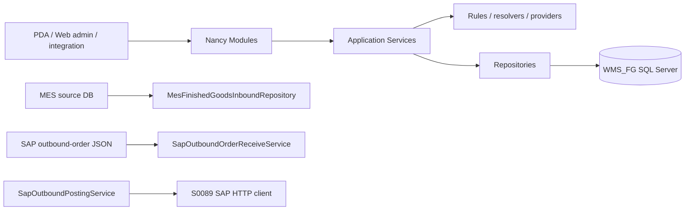
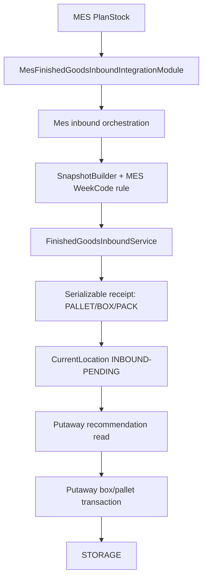
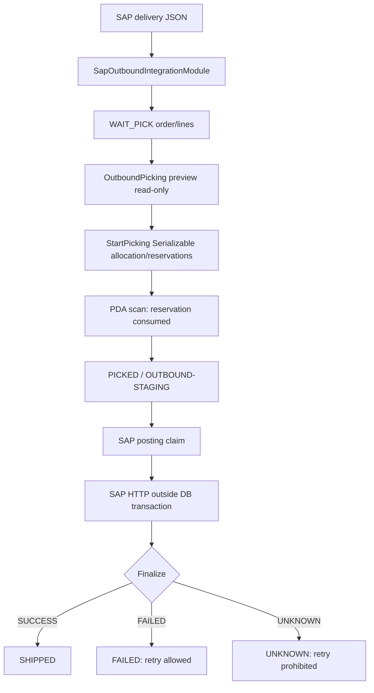

# WMS Runtime Functional Module Inventory

> Task: `WMS_RUNTIME_FUNCTIONAL_MODULE_INVENTORY`  
> Source authority: current source tree, inspected 2026-08-31.  
> Scope: read-only source inventory. No SQL connection, migration, HTTP write call, build, or Runtime test was run for this report. `CODEX_DB_CONNECTION_REQUIRED=FALSE`; database validation remains `MANUAL_SQL_EXECUTION`.

## 1. Executive Summary

The current Nancy host contains **23 Modules** and **85 registered HTTP routes**. Runtime composition is constructor-based inside Module classes; `WMS/Bootstrapper.cs` is the standard `DefaultNancyBootstrapper` and does not add a separate registration list. The confirmed formal-outbound separation is present:

`OutboundOrderModule` (order/read/void) → `OutboundPickingModule` (preview/reserve/scan) → `OutboundExceptionModule` (return/replacement) → `OutboundSapPostingModule` (SAP posting and shipment confirmation).

WMS final-schema SQL uses the `dbo.WMS_FG_*` table family. Where old non-FG table names appear in historical documents, this report deliberately uses only current `WMS_FG_*` source references.

## 2. Runtime Architecture Overview



Common response adaptation is `OperationResult<T>` → `ApiResult`. Modules are HTTP adapters; business validation and orchestration reside in Services; SQL, transactions and locks reside in repositories.

## 3. Module Inventory

| Module | Source file | Business category | Routes | Primary services | Other runtime dependencies |
|---|---|---:|---:|---|---|
| AuditModule | `WMS/Modules/AuditModule.cs` | Other / Audit | 5 | IAuditService/AuditService | IAuditRepository/AuditRepository |
| HealthModule | `WMS/Modules/HealthModule.cs` | System / Monitoring | 2 | none | DbConnectionFactory (DB health only) |
| MonitoringModule | `WMS/Modules/MonitoringModule.cs` | System / Monitoring | 2 | IMonitoringService/MonitoringService | MonitoringRepository; inbound read; WeekCode audit |
| MasterDataMaintenanceModule | `WMS/Modules/MasterDataMaintenanceModule.cs` | Warehouse Master Data | 13 | IMasterDataMaintenanceService/MasterDataMaintenanceService | MasterDataMaintenanceRepository |
| LocationModule | `WMS/Modules/LocationModule.cs` | Warehouse Master Data | 8 | ILocationService/LocationService | LocationRepository |
| HuModule | `WMS/Modules/HuModule.cs` | HU / Location | 7 | IHuService/HuService; IHuHoldService/HuHoldService | HuRepository; HuHoldRepository |
| HuLocationModule | `WMS/Modules/HuLocationModule.cs` | Movement | 3 | IHuLocationService/HuLocationService | HU, Location, HU-location repositories |
| HuDetailModule | `WMS/Modules/HuDetailModule.cs` | HU / Location | 3 | IHuDetailService/HuDetailService | HuDetailRepository; HuLocationService |
| InventoryQueryModule | `WMS/Modules/InventoryQueryModule.cs` | Inventory / Query | 1 | IInventoryQueryService/InventoryQueryService | InventoryQueryRepository; HU identifier; EffectiveLocationResolver |
| FinishedGoodsInventoryModule | `WMS/Modules/FinishedGoodsInventoryModule.cs` | Inventory / Query | 2 | IFinishedGoodsInventoryService/FinishedGoodsInventoryService | FinishedGoodsInventoryRepository |
| FinishedGoodsInboundIntegrationModule | `WMS/Modules/FinishedGoodsInboundIntegrationModule.cs` | Inbound | 1 | IFinishedGoodsInboundService/FinishedGoodsInboundService | FinishedGoodsInboundRepository; WeekCodeResolver |
| MesFinishedGoodsInboundIntegrationModule | `WMS/Modules/MesFinishedGoodsInboundIntegrationModule.cs` | Inbound / MES Integration | 1 | IMesFinishedGoodsInboundOrchestrationService/MesFinishedGoodsInboundOrchestrationService | MES graph/rule repositories, snapshot builder, inbound service |
| FinishedGoodsInboundReadModule | `WMS/Modules/FinishedGoodsInboundReadModule.cs` | Inbound | 2 | IFinishedGoodsInboundReadService/FinishedGoodsInboundReadService | read repository; EffectiveLocationResolver |
| PutawayModule | `WMS/Modules/PutawayModule.cs` | Putaway | 5 | IPutawayService/PutawayService; IPutawayRecommendationService/PutawayRecommendationService | HU/location/putaway and recommendation repositories |
| RelocationModule | `WMS/Modules/RelocationModule.cs` | Movement | 1 | IRelocationService/RelocationService | RelocationRepository |
| RepackModule | `WMS/Modules/RepackModule.cs` | Repack / Split / Merge | 6 | IRepackService/RepackService | HU/location/repack repositories |
| WeekCodeAuditModule | `WMS/Modules/WeekCodeAuditModule.cs` | WeekCode | 1 | IWeekCodeAuditService/WeekCodeAuditService | audit repository; MES pack-time reader |
| WeekCodeRecalculateModule | `WMS/Modules/WeekCodeRecalculateModule.cs` | WeekCode | 1 | IWeekCodeRecalculateService/WeekCodeRecalculateService | recalc repository; MES rule provider; resolver |
| OutboundOrderModule | `WMS/Modules/OutboundOrderModule.cs` | Formal Outbound Order | 4 | IOutboundOrderService/OutboundOrderService | OutboundOrderRepository |
| OutboundPickingModule | `WMS/Modules/OutboundPickingModule.cs` | Formal Outbound Picking | 4 | IOutboundPickingService/OutboundPickingService | Picking/order repositories; HU identifier service |
| OutboundExceptionModule | `WMS/Modules/OutboundExceptionModule.cs` | Outbound Exception | 3 | IOutboundExceptionService/OutboundExceptionService | OutboundExceptionRepository |
| OutboundSapPostingModule | `WMS/Modules/OutboundSapPostingModule.cs` | SAP Outbound Posting | 7 | ISapOutboundPostingService/SapOutboundPostingService | Posting repository; `S0089SapOutboundPostingClient` |
| SapOutboundIntegrationModule | `WMS/Modules/SapOutboundIntegrationModule.cs` | SAP Integration / Receive | 3 | ISapOutboundOrderReceiveService; ISapOutboundPostingService | Receive/posting repositories; S0089 client |

## 4. System / Monitoring

### Module: HealthModule

**A. Basic Information**  
Source file: `WMS/Modules/HealthModule.cs`. Business category: System / Monitoring. Primary purpose: liveness and optional WmsDb connectivity probe. Primary caller/use case: monitoring/general API.

**B. HTTP Routes**

| HTTP Method | Route | Request Model / Parameters | Service Method | Purpose |
|---|---|---|---|---|
| GET | `/api/health` | none | none | Return WMS running/framework/time facts. |
| GET | `/api/health/db` | none | direct `DbConnectionFactory` query | Open WmsDb and report server/database time. |

**C–E. Service / Repository / Rules**: no Service interface, repository or business rule; `/health/db` issues direct scalar metadata SQL.

**F. Database Tables**: none; `/health/db` reads SQL Server metadata (`@@SERVERNAME`, `DB_NAME`, `GETDATE`) only. **G. Validation**: connection exception becomes `ApiResult.Code=500`. **H. State changes**: none. **I. Transaction/locking**: none. **J. Idempotency**: naturally idempotent. **K. External integration**: none. **L. Output**: service/status/framework/time, or connected/server/database/database-time. **M. Business Summary**: probe → optional DB open → health result.

### Module: MonitoringModule

**A. Basic Information**  
Source: `WMS/Modules/MonitoringModule.cs`; category System / Monitoring; caller monitoring/web admin. It aggregates business health, inbound records and WeekCode audit findings rather than changing business state.

**B. HTTP Routes**

| HTTP Method | Route | Request | Service Method | Purpose |
|---|---|---|---|---|
| GET | `/api/wms/monitoring/overview` | none | `GetOverview` | DB/MES probe and summarized operating facts. |
| GET | `/api/wms/monitoring/activity` | `days:int` query (parsed, service default/range rules) | `GetActivity` | recent receipt/activity trend. |

**C. Service Layer**: `IMonitoringService` / `MonitoringService`, `WMS-HU-Model/Services/MonitoringService.cs`; `GetOverview` calls `IMonitoringRepository.ProbeWmsDb`, `ProbeMesDb`, `GetBusinessSummary` and related inbound/WeekCode service reads; `GetActivity` reads activity/trend.

**D. Repository Layer**: `IMonitoringRepository` / `MonitoringRepository`, `Repositories/Impl/MonitoringRepository.cs`: probe WMS/MES connections and read business summary/trend. Indirect read interfaces: `IFinishedGoodsInboundReadService`, `IWeekCodeAuditService`.

**E–M. Rules**: no canonical mutation rule. Tables are read-only WMS receipt/HU/hold business-summary inputs and MES connectivity/source reads. Validation is query-day parsing and repository probe failures. No state change, transaction, lock or OperationLog; naturally idempotent. Output is `MonitoringOverviewDto`/`MonitoringActivityDto`. Summary: monitoring query → aggregate WMS/MES facts → dashboard result.

### Module: AuditModule

**A. Basic Information**: `WMS/Modules/AuditModule.cs`; Other / Audit; general API/web admin. It is a historical read surface.

**B. HTTP Routes**

| HTTP Method | Route | Request Model / Parameters | Service Method | Purpose |
|---|---|---|---|---|
| GET | `/api/wms/audit/operations` | dateFrom/dateTo/huCode/requestId/operator/operationType/page/pageSize | `QueryOperations` | Paginate HU operations. |
| GET | `/api/wms/audit/moves` | dateFrom/dateTo/huCode/requestId/operator/moveType/page/pageSize | `QueryMoves` | Paginate moves. |
| GET | `/api/wms/audit/holds` | dateFrom/dateTo/huCode/requestId/operator/holdReason/status/page/pageSize | `QueryHolds` | Paginate hold history. |
| GET | `/api/wms/audit/request-trace` | `requestId` | `GetRequestTrace` | Combine operation/move/hold records for a request. |
| GET | `/api/wms/audit/capabilities` | none | `GetCapabilities` | Publish supported audit filters/capabilities. |

**C. Service Layer**: `IAuditService` / `AuditService`, `Services/AuditService.cs`; normalizes page bounds and delegates filtering, then builds request trace. **D. Repository**: `IAuditRepository` / `AuditRepository`, `Repositories/Impl/AuditRepository.cs`: `QueryOperations`, `QueryMoves`, `QueryHolds`, and the three `Get*ByRequestId` methods read log history.

**E–M. Rules**: audit service owns query normalization; tables read: `WMS_FG_HU_OperationLog`, `WMS_FG_HU_MoveLog`, `WMS_FG_HU_HoldLog`, with HU code joins. No insert/update, transaction, locks or idempotency state. Outputs `AuditPageResult`, `RequestAuditTraceDto`, capability DTOs. Summary: filter → log repository reads → immutable audit response.

## 5. Warehouse / Master Data

### Module: MasterDataMaintenanceModule

**A. Basic Information**: `WMS/Modules/MasterDataMaintenanceModule.cs`; Warehouse Master Data; web admin/general API; manages Warehouse and WarehousePlant master rows.

**B. HTTP Routes**

| Method | Route | Request | Service Method | Purpose |
|---|---|---|---|---|
| GET | `/api/wms/master-data/options` | `warehouseCode?` | `GetOptions` | warehouse/zone selection data |
| GET | `/warehouses` | code/name/isActive/page/pageSize queries | `QueryWarehouses` | warehouse list |
| GET | `/warehouses/{warehouseCode}` | path | `GetWarehouse` | one warehouse |
| POST | `/warehouses` | `WarehouseCreateRequest` | `CreateWarehouse` | create warehouse |
| POST | `/warehouses/{warehouseCode}/update` | `WarehouseUpdateRequest` | `UpdateWarehouse` | change master values |
| POST | `/warehouses/{warehouseCode}/enable` | `MasterDataStatusRequest` | `SetWarehouseActive(true)` | enable |
| POST | `/warehouses/{warehouseCode}/disable` | `MasterDataStatusRequest` | `SetWarehouseActive(false)` | disable guarded master |
| GET | `/warehouse-plants` | warehouseCode/plantCode/isActive/page/pageSize | `QueryWarehousePlants` | mapping list |
| GET | `/warehouse-plants/{warehouseCode}/{plantCode}` | path | `GetWarehousePlant` | mapping read |
| POST | `/warehouse-plants` | `WarehousePlantCreateRequest` | `CreateWarehousePlant` | create mapping |
| POST | `/warehouse-plants/{warehouseCode}/{plantCode}/update` | `WarehousePlantUpdateRequest` | `UpdateWarehousePlant` | update mapping |
| POST | `/warehouse-plants/{warehouseCode}/{plantCode}/enable` | `MasterDataStatusRequest` | `SetWarehousePlantActive(true)` | enable mapping |
| POST | `/warehouse-plants/{warehouseCode}/{plantCode}/disable` | `MasterDataStatusRequest` | `SetWarehousePlantActive(false)` | disable mapping |

**C. Service Layer**: `IMasterDataMaintenanceService` / `MasterDataMaintenanceService`, `Services/MasterDataMaintenanceService.cs`; validates codes/status request and prevents unsafe disabling before repository changes. **D. Repository**: `IMasterDataMaintenanceRepository` / `MasterDataMaintenanceRepository`, `Repositories/Impl/MasterDataMaintenanceRepository.cs`; `Query/Get/Exists/Insert/Update/SetActive` for warehouses/mappings, plus `HasActiveLocations`, `HasCurrentHus`, `HasActiveMappings`, option readers.

**E–M. Rules**: warehouse and plant mapping are canonical master-data authorities. Read/write tables: `WMS_FG_Warehouse` and `WMS_FG_WarehousePlant`; disable guards read `WMS_FG_Location` and `WMS_FG_HU_CurrentLocation`. Changes are ACTIVE ↔ inactive flags, not inventory transitions. Repository write methods perform their own DB statements; no external call/OperationLog is shown. Create is non-idempotent; update/status use conditional affected-row/existence checks. Results are warehouse/mapping/options DTOs. Summary: admin command → dependency guard → master row persist → active/inactive master fact.

### Module: LocationModule

**A. Basic Information**: `WMS/Modules/LocationModule.cs`; Warehouse Master Data; web admin/general API; maintains location master data.

**B. HTTP Routes**

| Method | Route | Request | Service Method | Purpose |
|---|---|---|---|---|
| GET | `/api/wms/locations/` | `warehouseCode?`, `zoneCode?` | `GetList` | active location list |
| GET | `/maintenance` | maintenance query | `GetMaintenanceList` | administrative list |
| GET | `/{warehouseCode}/{locationCode}` | path | `Get` | one location |
| POST | `/` | `CreateLocationRequest` | `Create` | create location |
| PUT | `/{warehouseCode}/{locationCode}` | `UpdateLocationRequest` | `Update` | update location |
| POST | `/{warehouseCode}/{locationCode}/update` | `UpdateLocationRequest` | `Update` | compatibility update route |
| POST | `/{warehouseCode}/{locationCode}/enable` | `MasterDataStatusRequest` | `SetActive(true)` | enable |
| POST | `/{warehouseCode}/{locationCode}/disable` | `MasterDataStatusRequest` | `SetActive(false)` | disable if empty |

**C. Service**: `ILocationService` / `LocationService`, `Services/Impl/LocationService.cs`; validates warehouse/location values and blocks disabling locations with current HU. **D. Repository**: `ILocationRepository` / `LocationRepository`, `Repositories/Impl/LocationRepository.cs`; `GetList`, `GetMaintenanceList`, `GetByCode`, `Exists`, `Insert`, `Update`, `CountCurrentHus`, `SetActive`.

**E–M. Rules**: location master is canonical for physical/virtual location attributes. Tables: R/W `WMS_FG_Location`; disable guard R `WMS_FG_HU_CurrentLocation`. Master status toggles active state; no external integration/OperationLog. Create/update/status are conditional writes; reads naturally idempotent. Output is `LocationDto`/list. Summary: location command → validity/occupancy check → master-data write → updated location.

## 6. HU / Location

### Module: HuModule

**A. Basic Information**: `WMS/Modules/HuModule.cs`; HU / Location; PDA/general API; creates, links, inspects and holds HUs.

**B. HTTP Routes**

| Method | Route | Request | Service Method | Purpose |
|---|---|---|---|---|
| POST | `/api/wms/hus/{huCode}/hold` | `HoldHuRequest` | `HuHoldService.Hold` | create active hold |
| POST | `/{huCode}/release` | `ReleaseHuRequest` | `HuHoldService.Release` | release active hold |
| GET | `/{huCode}` | path | `HuService.Get` | HU read |
| POST | `/` | `CreateHuRequest` | `HuService.Create` | create HU |
| POST | `/attach` | `AttachHuRequest` | `HuService.Attach` | parent-child relation |
| POST | `/{huCode}/items` | `AddHuItemRequest` | `HuService.AddItem` | add stock item |
| GET | `/{huCode}/tree` | path | `HuService.GetTree` | hierarchy tree |

**C. Service Layer**: `IHuService` / `HuService`, `Services/Impl/HuService.cs`: validates HU type/identity, detects cycles/active parent restrictions, resolves WeekCode for item write when configured, and builds hierarchy. `IHuHoldService` / `HuHoldService`, `Services/Impl/HuHoldService.cs`: validates hold/release requests.

**D. Repository Layer**: `IHuRepository` / `HuRepository`, `Repositories/Impl/HuRepository.cs`: `GetByCode`, type/plant reads, `Create`, parent/cycle checks, `Attach`, `AddItem`, `GetTree`, `GetItems`. `IHuHoldRepository` / `HuHoldRepository`, `Repositories/Impl/HuHoldRepository.cs`: `Hold`, `Release` (transactional hold change).

**E–M. Rules**: WeekCodeResolver can be used for item WeekCode; HU hierarchy is canonical in `WMS_FG_HU_Relation`. Tables R/W: `WMS_FG_HU`, `WMS_FG_HU_Relation`, `WMS_FG_HU_Item`, `WMS_FG_HU_HoldLog`, and operation logging. Validations include code, type, parent/child compatibility, active parent, cycle, active HU/hold. State changes: active hold false → true and true → false; attach activates a relation; item adds active stock. Writes use repository transactions/operation logs and RequestId where request supports it; reads are idempotent. Outputs Hu/Hold/item/tree DTOs. Summary: scan/admin request → HU and hierarchy/hold validation → persisted HU fact → queryable hierarchy and audit history.

### Module: HuLocationModule

**A. Basic Information**: `WMS/Modules/HuLocationModule.cs`; Movement; PDA/general API; resolves and atomically moves HU location.

**B. HTTP Routes**

| Method | Route | Request | Service Method | Purpose |
|---|---|---|---|---|
| GET | `/api/wms/hus/{huCode}/location` | path | `GetLocation` | effective/current location |
| POST | `/{huCode}/move` | `HuMoveRequest` | `Move` | single-HU move |
| GET | `/{huCode}/moves` | `top?` (default 50) | `GetMoveLogs` | move history |

**C. Service**: `IHuLocationService` / `HuLocationService`, `Services/Impl/HuLocationService.cs`; loads HU, validates lifecycle/hold/type/location/warehouse-plant boundary and turns scan request into `HuMoveCommand`.

**D. Repository**: `IHuLocationRepository` / `HuLocationRepository`, `Repositories/Impl/HuLocationRepository.cs`: `WarehouseAllowsPlant`, `CountDifferentPlantAtLocation`, `GetMoveByRequestId`, `ExecuteMove`, `GetMoveLogs`. Indirect `IHuRepository`/`ILocationRepository` provide HU and target facts.

**E–M. Rules**: CurrentLocation is persisted authority; effective location can fall back through parent relation where used. Tables R/W: `WMS_FG_HU`, `WMS_FG_Location`, `WMS_FG_WarehousePlant`, `WMS_FG_HU_CurrentLocation`, `WMS_FG_HU_MoveLog`, `WMS_FG_HU_OperationLog`. `ExecuteMove` is one atomic repository transaction with request-id replay lookup and affected-row validation. It records from/to locations and move log; no HTTP inside transaction. Summary: HU/location scan → boundary/status checks → atomic current-location replacement/log → move result including duplicate indication.

### Module: HuDetailModule

**A. Basic Information**: `WMS/Modules/HuDetailModule.cs`; HU / Location; PDA/web admin read detail.

**B. HTTP Routes**: `GET /api/wms/hus/{huCode}/detail` → `GetDetail`; `GET /{huCode}/operations?top=` → `GetOperationLogs`; `GET /{huCode}/holds?top=` → `GetHoldLogs`.

**C. Service**: `IHuDetailService` / `HuDetailService`, `Services/HuDetailService.cs`; finds HU, attaches location detail and history. **D. Repositories**: `IHuDetailRepository` / `HuDetailRepository`, `Repositories/Impl/HuDetailRepository.cs`: `GetContents`, `GetActiveHold`, `GetOperationLogs`, `GetHoldLogs`; indirect `HuRepository`, `HuLocationService` and its repositories. **E–M**: Reads canonical HU, active contents, CurrentLocation, operation and hold logs; no writes/transactions/idempotency state/external calls. Result is `HuDetailDto` with identity, contents, effective location and active hold, or log lists. Summary: HU code → existence/location/content/history reads → detailed HU view.

## 7. Inbound

### Module: FinishedGoodsInboundIntegrationModule

**A. Basic Information**: `WMS/Modules/FinishedGoodsInboundIntegrationModule.cs`; Inbound; MES/general integration. It receives an already-built finished-goods snapshot.

**B. HTTP Routes**: `POST /api/wms/integration/finished-goods/inbound` | `FinishedGoodsInboundReceiveRequest` | `IFinishedGoodsInboundService.Receive` | receive snapshot.

**C. Service**: `IFinishedGoodsInboundService` / `FinishedGoodsInboundService`, `Services/Impl/FinishedGoodsInboundService.cs`; validates request/snapshot, hashes canonical snapshot, finds prior receipt, resolves each pack WeekCode and persists. **D. Repository**: `IFinishedGoodsInboundRepository` / `FinishedGoodsInboundRepository`, `Repositories/Impl/FinishedGoodsInboundRepository.cs`: `FindExisting`, `Persist`.

**E. Rules**: `WeekCodeResolver` with `UnavailableWeekCodeRuleProvider` in this direct endpoint; the resolver owns WeekCode derivation, not client payload. **F. Tables**: W `WMS_FG_FinishedGoodsInboundReceipt`, `WMS_FG_HU`, `WMS_FG_HU_Identifier`, `WMS_FG_HU_Relation`, `WMS_FG_HU_Item`, `WMS_FG_HU_CurrentLocation`, `WMS_FG_HU_MoveLog`, `WMS_FG_HU_OperationLog`, and unresolved `WMS_FG_HU_HoldLog`; R `WMS_FG_Location`, `WMS_FG_WarehousePlant` plus duplicate/barcode reads.

**G–M. Validation**: source identity/hash structural constraints, required operator, barcode uniqueness, valid `INBOUND-PENDING` virtual location, and WeekCode preparation. Unresolved WeekCode does not block physical receive: OUTER_BOX gets `WEEKCODE_UNRESOLVED` hold. `Persist` uses one Serializable transaction, locks existing receipt with `UPDLOCK,HOLDLOCK`, and acquires barcode application locks; HTTP is outside it. Idempotency is `SourceSystem+SourceType+SourceEntityId` plus SnapshotHash/HashVersion: same snapshot returns duplicate, different hash conflicts. It writes RECEIVE/CREATE_HU/ATTACH_HU/HU_HOLD operations. Output: receipt identity/hash/time/duplicate. Summary: snapshot → validate/hash/WeekCode → one transactional PALLET→OUTER_BOX→INNER_PACK receive and INBOUND-PENDING location → receipt result.

### Module: MesFinishedGoodsInboundIntegrationModule

**A. Basic Information**: `WMS/Modules/MesFinishedGoodsInboundIntegrationModule.cs`; Inbound / MES Integration; MES integration caller. **B. Route**: `POST /api/wms/integration/finished-goods/mes-inbound` | `MesFinishedGoodsInboundTriggerRequest.PlanStockId` | `Trigger` | read MES source then receive.

**C. Service**: `IMesFinishedGoodsInboundOrchestrationService` / `MesFinishedGoodsInboundOrchestrationService`, `Services/MesFinishedGoodsInboundOrchestrationService.cs`; obtains source graph, snapshot-builds it, enriches consistent box rule values, and calls `FinishedGoodsInboundService.Receive`. **D. Repositories**: `IMesFinishedGoodsInboundRepository` / `MesFinishedGoodsInboundRepository`, `Repositories/Impl/MesFinishedGoodsInboundRepository.cs`: `GetPlanStock`; `IMesWeekCodeRuleRepository` / `MesWeekCodeRuleRepository`: `Read`; then inbound repository above.

**E–M. Rules**: `MesFinishedGoodsInboundSnapshotBuilder` maps source graph; `MesWeekCodeRuleProvider` is MES rule authority; `WeekCodeResolver` applies rule. MES source tables R: `PK_PlanStock`, `PK_Box`, `PK_Packmaster`; rule/master tables R: `MD_Flow`, `MD_FlowStation`, `MD_StationAttValue`. WMS writes/transaction/idempotency/state/output are exactly the inbound receive path. No write occurs in MES path. Summary: PlanStockId → MES graph/rule read → snapshot/WeekCode enrichment → transactional WMS receipt.

### Module: FinishedGoodsInboundReadModule

**A. Basic Information**: `WMS/Modules/FinishedGoodsInboundReadModule.cs`; Inbound; web admin/general API receipt lookup.

**B. HTTP Routes**: `GET /api/wms/inbound/finished-goods/receipts/` | `FinishedGoodsInboundRecordQuery` (date, plant, source, pallet/box/material/request/exception filters, page) | `Query`; `GET /{receiptId}` | path long | `GetDetail`.

**C. Service**: `IFinishedGoodsInboundReadService` / `FinishedGoodsInboundReadService`, `Services/FinishedGoodsInboundReadService.cs`; normalizes page/limits and enriches receipt rows with effective locations. **D. Repositories**: `IFinishedGoodsInboundReadRepository` / `FinishedGoodsInboundReadRepository`, `Repositories/Impl/FinishedGoodsInboundReadRepository.cs`: `Query`, `GetDetail`; `IEffectiveLocationResolver` / `EffectiveLocationResolver`: `ResolveMany`.

**E–M**: canonical receipt/HU/relationship/item/hold and location facts are read only. No state/transaction/idempotency external integration. Result is paged receipt records and receipt hierarchy/detail with location source. Invalid receipt ID yields 400; missing record yields 404. Summary: filter/id → receipt/HU hierarchy read plus effective-location enrichment → inbound history response.

## 8. Putaway

### Module: PutawayModule

**A. Basic Information**: `WMS/Modules/PutawayModule.cs`; Putaway; PDA/web admin. It keeps recommendation read-only separate from execution.

**B. HTTP Routes**

| Method | Route | Request | Service Method | Purpose |
|---|---|---|---|---|
| GET | `/api/wms/putaway/recommendations` | warehouseCode, boxHuCode | `GetRecommendations` | read-only recommended targets |
| GET | `/pallet/{palletHuCode}` | path | `GetPalletStatus` | pallet contents/status |
| GET | `/pallet/by-box/{boxHuCode}` | path | `GetPalletContextByBox` | locate parent pallet context |
| POST | `/box` | `PutawayBoxRequest` | `PutawayBox` | put one outer box away |
| POST | `/pallet` | `WholePalletPutawayRequest` | `PutawayPallet` | put whole pallet contents away |

**C. Services**: `IPutawayService` / `PutawayService`, `Services/Impl/PutawayService.cs`: validates pallet/box/target/scan, chooses direct-receive vs standard path, and invokes execution repository. `IPutawayRecommendationService` / `PutawayRecommendationService`, `Services/Impl/PutawayRecommendationService.cs`: evaluates snapshot into recommendations without movement.

**D. Repositories**: `IPutawayRepository` / `PutawayRepository`, `Repositories/Impl/PutawayRepository.cs`: `GetPalletStatus`, `GetByRequestId`, `ExecutePutaway`, direct-receive/whole-pallet methods; `IPutawayRecommendationRepository` / `PutawayRecommendationRepository`: `LoadSnapshot`; indirect HU/location/HU-location repositories.

**E–M**: recommendation owns no canonical fact; CurrentLocation/move log are authorities. Reads: HU, relation, item, Location, WarehousePlant, CurrentLocation. Writes: CurrentLocation, MoveLog, OperationLog and relationship/location effects from putaway. Execution validates pallet/box types, active hierarchy, target warehouse/plant and scanned location. Box/pallet execute as repository transactions with request-id duplicate readers; no HTTP within transaction. State/location: `INBOUND-PENDING → STORAGE` (or the requested active target); pallet status may close when empty. Outputs recommendation clusters or operation/move/remaining-box/duplicate DTOs. Summary: recommendation is snapshot-only; execution scans valid HU/target → atomic location/move persistence → putaway status.

## 9. Movement

### Module: RelocationModule

**A. Basic Information**: `WMS/Modules/RelocationModule.cs`; Movement; PDA/batch operator. **B. Route**: `POST /api/wms/relocation/batch` | `BatchRelocationRequest` | `IRelocationService.MoveBatch` | move multiple boxes/HUs.

**C. Service**: `IRelocationService` / `RelocationService`, `Services/Impl/RelocationService.cs`; validates request fields and delegates a batch command. **D. Repository**: `IRelocationRepository` / `RelocationRepository`, `Repositories/Impl/RelocationRepository.cs`: `GetByRequestId`, `ExecuteBatch`.

**E–M**: the repository is canonical writer for batch CurrentLocation and move/operation logs. It reads target/location/HU status and writes `WMS_FG_HU_CurrentLocation`, `WMS_FG_HU_MoveLog`, `WMS_FG_HU_OperationLog`; validates all HUs before the atomic batch execution. RequestId protects retry by returning stored result. Transaction/locks are repository-owned; no external call. Output identifies moved/skipped boxes and operation/request result. Summary: batch request → validate HUs/location → one repository movement transaction/logs → batch relocation result.

## 10. Repack / Split / Merge

### Module: RepackModule

**A. Basic Information**: `WMS/Modules/RepackModule.cs`; Repack / Split / Merge; PDA/repack station.

**B. HTTP Routes**

| Method | Route | Request | Service Method | Purpose |
|---|---|---|---|---|
| GET | `/api/wms/repack/boxes/{boxHuCode}` | path | `GetBoxStatus` | source box status |
| POST | `/transfer-inner` | `TransferInnerRequest` | `TransferInner` | move inner pack box→box |
| POST | `/unpack-inner` | `UnpackInnerRequest` | `UnpackInner` | remove inner pack to location |
| POST | `/unpack-box` | `UnpackBoxRequest` | `UnpackBox` | whole-box unpack flow |
| POST | `/merge-box` | `MergeBoxRequest` | `MergeBox` | merge source into target box |
| POST | `/pack-inner` | `PackInnerRequest` | `PackInner` | put loose inner pack into box |

**C. Service**: `IRepackService` / `RepackService`, `Services/Impl/RepackService.cs`; resolves codes, validates HU types, parent/active relation/current location/warehouse compatibility and prepares specific commands. **D. Repository**: `IRepackRepository` / `RepackRepository`, `Repositories/Impl/RepackRepository.cs`: status plus `Get*/Execute*` for inner unpack, pack, whole-box unpack, merge and transfer; specialized `WholeBoxUnpackRepository`/`MergeBoxRepository` exist in `Repositories/Impl` for their command transactions.

**E–M**: HU relation and CurrentLocation are canonical. Tables R/W: `WMS_FG_HU`, `WMS_FG_HU_Relation`, `WMS_FG_HU_Item`, `WMS_FG_HU_CurrentLocation`, `WMS_FG_HU_MoveLog`, `WMS_FG_HU_OperationLog`, Location. Validations enforce OUTER_BOX/INNER_PACK roles, active lifecycle/relation and target compatibility. Each execution is repository transaction and RequestId idempotent (`Get*ByRequestId`); affected-row/state checks prevent stale structure. Relationship changes include active parent switch or deactivation; locations move box/inner-pack between storage and contained context. Outputs operation/move/source-remaining/duplicate results. Summary: repack command → type/relation/location validation → atomic relation and location/log update → changed HU hierarchy.

## 11. Inventory / Query

### Module: InventoryQueryModule

**A. Basic Information**: `WMS/Modules/InventoryQueryModule.cs`; Inventory / Query; PDA/general lookup. **B. Route**: `GET /api/wms/inventory/lookup?warehouseCode=&code=` → `InventoryQueryService.Lookup` → resolve a location or HU scan code.

**C. Service**: `IInventoryQueryService` / `InventoryQueryService`, `Services/InventoryQueryService.cs`; normalizes code, identifies a warehouse location or HU identifier and constructs inventory hierarchy. **D. Repositories**: `IInventoryQueryRepository` / `InventoryQueryRepository`, `Repositories/Impl/InventoryQueryRepository.cs`: `GetLocation`, `FindLocation`, `GetHu`, location/box/pack fact readers and `GetActiveParentBoxCode`; `IHuIdentifierService` / `HuIdentifierService` → `HuIdentifierRepository`; `IEffectiveLocationResolver`.

**E–M**: HU identifier service is canonical scan-code resolver; effective location is resolved read authority. Read tables: Location, HU, Identifier, Relation, Item, CurrentLocation; no writes/transaction/OperationLog. Guards distinguish unknown code and warehouse mismatch. Output `InventoryLookupDto` contains resolved location/HU, hierarchy, material/qty/WeekCode and effective-location source. Summary: code → location-or-identifier resolution → inventory facts → read-only lookup.

### Module: FinishedGoodsInventoryModule

**A. Basic Information**: `WMS/Modules/FinishedGoodsInventoryModule.cs`; Inventory / Query; web admin/general API.

**B. Routes**: `GET /api/wms/inventory/finished-goods/` with plant/material/revision/box/innerPack/location/week/stock/hold/page filters → `Query`; `GET /{boxCode}/preview` → `GetPreview`.

**C. Service**: `IFinishedGoodsInventoryService` / `FinishedGoodsInventoryService`, `Services/FinishedGoodsInventoryService.cs`; normalizes page and validates query/box code. **D. Repository**: `IFinishedGoodsInventoryRepository` / `FinishedGoodsInventoryRepository`, `Repositories/Impl/FinishedGoodsInventoryRepository.cs`: `Query`, `GetPreview`.

**E–M**: reads finished goods HU/Relation/Item/CurrentLocation/Location/Hold data, including WeekCode and hold status; no mutation or external call. Query type and pagination/isHold parsing are guards. Output is paged inventory and box preview DTO. Summary: inventory filter → active HU/item/location read → FIFO/WeekCode/hold-aware inventory response.

## 12. WeekCode

### Module: WeekCodeAuditModule

**A. Basic Information**: `WMS/Modules/WeekCodeAuditModule.cs`; WeekCode; web admin/monitoring. **B. Route**: `GET /api/wms/weekcode/audit` with plant/material/revision/anomaly/risk/isHold/page/pageSize → `IWeekCodeAuditService.Query` → find WeekCode anomalies.

**C. Service**: `IWeekCodeAuditService` / `WeekCodeAuditService`, `Services/WeekCodeAuditService.cs`; validates page/filter, caps candidates at 5000, enriches MES pack creation time and evaluates rule/date risk. **D. Repositories**: `IWeekCodeAuditRepository` / `WeekCodeAuditRepository`, `Repositories/Impl/WeekCodeAuditRepository.cs`: `QueryFacts`; `MesFinishedGoodsInboundRepository.GetPackCreatedTimes` indirect.

**E–M**: evaluation canonicalizes audit classification only; it does not modify WeekCode/hold. WMS R: HU, Relation, Item, HoldLog; MES R: pack creation facts. Guards: page 1–200, valid bool, max candidate count. No transaction/idempotency/log write/external HTTP. Output reports RULE_MISSING, RULE_UNSUPPORTED, INVALID_DATECODE, SUSPICIOUS_YEAR or SUSPICIOUS_RULE_DIRECTION facts. Summary: filters → WMS/MES fact read → risk evaluation → audit result.

### Module: WeekCodeRecalculateModule

**A. Basic Information**: `WMS/Modules/WeekCodeRecalculateModule.cs`; WeekCode; web admin/internal operation. **B. Route**: `POST /api/wms/weekcode/recalculate` | `WeekCodeRecalculateRequest` | `WeekCodeRecalculateService.Recalculate` | rederive item WeekCode for selected plant/material/revision.

**C. Service**: `IWeekCodeRecalculateService` / `WeekCodeRecalculateService`, `Services/WeekCodeRecalculateService.cs`; validates all selector/operator/request-id fields, obtains MES rule, loads eligible boxes, resolves each pack and applies only changed boxes. **D. Repository**: `IWeekCodeRecalculateRepository` / `WeekCodeRecalculateRepository`, `Repositories/Impl/WeekCodeRecalculateRepository.cs`: `GetCurrentBoxes`, `ApplyBox`; MES rule and pack-source readers are indirect.

**E–M**: `MesWeekCodeRuleProvider` + `WeekCodeResolver` are canonical authorities; request has no RuleValue. Current eligible location prefers direct box CurrentLocation then active parent fallback and excludes SHIPPED. R: HU/Relation/Item/CurrentLocation/Location/HoldLog; W: Item WeekCode fields, a resolvable WEEKCODE_UNRESOLVED Hold release, HU hold indicator, OperationLog; MES rule/pack-time R. Each updated OUTER_BOX is a Serializable transaction with `UPDLOCK,HOLDLOCK`, revalidating selected item IDs. `RequestId` is logged but does not short-circuit into stored response; unchanged boxes do zero writes. Only active WEEKCODE_UNRESOLVED hold can auto-release when all items resolve; quality holds do not. Output has box/item UPDATED/UNCHANGED/FAILED results. Summary: selector → MES rule + active inventory read → per-box locked WeekCode update/conditional hold release → report.

## 13. Formal Outbound Order

### Module: OutboundOrderModule

**A. Basic Information**: `WMS/Modules/OutboundOrderModule.cs`; Formal Outbound Order; web admin/PDA order task view.

**B. Routes**: `GET /api/wms/outbound/orders` (`OutboundOrderQuery` → `GetOrders`); `GET /orders/{vbeln}` (`GetOrder`); `GET /orders/{vbeln}/picking-state` (`GetPickingState`); `POST /orders/{vbeln}/void` (`OutboundActionRequest` → `VoidOrder`).

**C. Service**: `IOutboundOrderService` / `OutboundOrderService`, `Services/Impl/OutboundOrderService.cs`; validates delivery/action request and delegates order/status actions. **D. Repository**: `IOutboundOrderRepository` / `OutboundOrderRepository`, `Repositories/Impl/OutboundOrderRepository.cs`: `GetOrders`, `GetOrder`, `VoidOrder`, `GetPickingState`.

**E–M**: outbound order is authority for delivery lifecycle. Reads: `WMS_FG_OutboundOrder`, `WMS_FG_OutboundOrderLine`, Allocation/Batch/Reservation data for picking state. Void writes order/allocation/reservation state and operation history within repository transaction; request ID protects action repeat. Guard: only eligible current order state can void; existing allocation/picking facts restrict it. Visible transition is `WAIT_PICK → VOID` (and repository releases active allocation/reservation as supported). Outputs order/line DTO, picking-state DTO, action result. Summary: delivery lookup or void command → current order-state guard → transactional state action → order task response.

## 14. Formal Outbound Picking

### Module: OutboundPickingModule

**A. Basic Information**: `WMS/Modules/OutboundPickingModule.cs`; Formal Outbound Picking; PDA/web picking.

**B. HTTP Routes**

| Method | Route | Request | Service Method | Purpose |
|---|---|---|---|---|
| POST | `/api/wms/outbound/orders/{vbeln}/preview` | no body | `Preview` | read-only allocation plan |
| POST | `/orders/{vbeln}/start-picking` | `StartPickingRequest` | `StartPicking` | reserve whole delivery |
| POST | `/allocations/{allocationNo}/release` | `OutboundActionRequest` | `ReleaseAllocation` | release active allocation |
| POST | `/pick-batches/{pickBatchNo}/scan` | `OutboundScanRequest` | `Scan` | scan reserved box/identifier |

**C. Service**: `IOutboundPickingService` / `OutboundPickingService`, `Services/Impl/OutboundPickingService.cs`; loads order; planner-based preview; validates request then turns start/scan into repository commands; scan resolves HUCode/identifier through `IHuIdentifierService` / `HuIdentifierService`.

**D. Repository**: `IOutboundPickingRepository` / `OutboundPickingRepository`, `Repositories/Impl/OutboundPickingRepository.cs`: `GetAllocationCandidates`, `GetStartPickingByRequestId`, `ExecuteStartPicking`, `ReleaseAllocation`, `GetPickBatchCustomerCode`, `GetScanByRequestId`, `ExecuteScan`; `IOutboundOrderRepository` supplies order facts. Planner is `Models/Rules/OutboundAllocationPlanner.cs`.

**E–M**: Planner is canonical pure allocation choice: earliest WeekCode, whole-box preference and exact quantity outcome. Preview is read-only. StartPicking obtains candidates and runs one Serializable transaction; allocation/order/line/reservation/batch state is locked/affected-row checked. Scan is one Serializable transaction with `UPDLOCK,HOLDLOCK,ROWLOCK` on reservation, HU, CurrentLocation, batch/allocation/order, detail sequence and item/line records. It moves a picked box from storage to outbound staging and logs it; no HTTP inside DB transaction. RequestId result readers protect StartPicking/Scan; release uses action RequestId. State changes: `WAIT_PICK → ALLOCATED`, first scan causes allocation `→ PICKING`; reservation `ACTIVE → CONSUMED`; batches/lines/order become `PICKED` when all criteria are met. Tables R/W include OutboundOrder/Line/Allocation/PickBatch/PickBatchDetail/PickDetail/PickDetailItem/HU_Reservation, HU/Relation/Item/CurrentLocation, MoveLog and OperationLog. Output: allocation plan, allocation/batches/reservations, scan detail/location/status/duplicate. Summary: preview or delivery start → current inventory planning/locked reservation → PDA scan consumes reservation and moves box → picking state result.

## 15. Outbound Exception

### Module: OutboundExceptionModule

**A. Basic Information**: `WMS/Modules/OutboundExceptionModule.cs`; Outbound Exception; PDA exception operator.

**B. Routes**: `POST /api/wms/outbound/pick-details/{detailId}/return` (`ReturnPickDetailRequest` → `ReturnPickDetail`); `POST /returned/{huCode}/putaway` (`ReturnToStockRequest` → `ReturnToStock`); `POST /pick-batches/{pickBatchNo}/replace` (`ReplacementRequest` → `ReserveReplacement`).

**C. Service**: `IOutboundExceptionService` / `OutboundExceptionService`, `Services/Impl/OutboundExceptionService.cs`; validates detail/HU/batch/action requests and invokes exception operations. **D. Repository**: `IOutboundExceptionRepository` / `OutboundExceptionRepository`, `Repositories/Impl/OutboundExceptionRepository.cs`: `ReturnPickDetail`, `ReturnToStock`, `ReserveReplacement`.

**E–M**: repository owns PickDetail, exception and replacement state. Tables R/W: `WMS_FG_OutboundPickDetail`, PickDetailItem, PickBatch/Detail, Allocation, Reservation, `WMS_FG_OutboundPickException`, HU/HoldLog/CurrentLocation, MoveLog, OperationLog. Returns are atomic repository transactions with current status/affected-row guards and request-id handling. Return moves `OUTBOUND-STAGING → RETURNED`; quality failure establishes an active hold when source requires it. Return-to-stock requires returned HU and valid target, moving `RETURNED → STORAGE`. Replacement preserves abnormal pick history, creates/reuses replacement reservation/batch detail and is RequestId idempotent. State flow supported: return creates an open exception and RETURNED inventory; replacement reservation then replacement scan allows exception resolution via picking path. Output action result or `StartPickingResultDto` reservation task. Summary: failed picked detail → transactional returned/exception record → optional replacement reservation → normal scan completes replacement.

## 16. SAP Posting

### Module: OutboundSapPostingModule

**A. Basic Information**: `WMS/Modules/OutboundSapPostingModule.cs`; SAP Outbound Posting; web admin/integration operator.

**B. HTTP Routes**

| Method | Route | Request | Service Method | Purpose |
|---|---|---|---|---|
| POST | `/api/wms/outbound/orders/{vbeln}/confirm-shipment` | `SapOutboundPostingControlRequest` | `ConfirmShipment` | claim/send/finalize SAP posting |
| GET | `/orders/{vbeln}/sap-posting-preview` | path | `Preview` | frozen/current payload preview |
| GET | `/orders/{vbeln}/shipping-state` | path | `GetShippingState` | outbound + SAP posting state |
| POST | `/orders/{vbeln}/sap-posting/retry` | control request | `Retry` | retry FAILED posting only |
| POST | `/orders/{vbeln}/sap-posting/manual-confirm-posted` | manual request | `ManualConfirmPosted` | currently rejected/deprecated authority bypass |
| POST | `/orders/{vbeln}/sap-posting/manual-confirm-not-posted` | manual request | `ManualConfirmNotPosted` | currently rejected/deprecated authority bypass |
| GET | `/shipping-orders` | delivery/outboundStatus/postingStatus/page/pageSize | `QueryShippingOrders` | posting work list |

**C. Service**: `ISapOutboundPostingService` / `SapOutboundPostingService`, `Services/Impl/SapOutboundPostingService.cs`; calls preview, claims initial/retry, invokes client **outside** DB transaction, finalizes attempt, and exposes state/log queries. **D. Repository**: `ISapOutboundPostingRepository` / `SapOutboundPostingRepository`, `Repositories/Impl/SapOutboundPostingRepository.cs`: `BuildPreview`, `ClaimInitial`, `ClaimRetry`, `FinalizeAttempt`, `GetShippingState`, query/log methods; manual confirmation methods explicitly throw that UNKNOWN must be SAP-authority checked.

**E–M**: `SapOutboundPayloadSerializer` builds canonical JSON/hash; `S0089SapOutboundPostingClient` (`WMS/Infrastructure/Sap/S0089SapOutboundPostingClient.cs`) is external HTTP transport. R: outbound/order/picked batch/detail/item/HU/current location. W: `WMS_FG_OutboundSapPosting`, `WMS_FG_OutboundSapPostingDetail`, `WMS_FG_SapIntegrationLog`, outbound order/line/batch/current location plus move/operation logs on successful shipment. Claim, retry and finalize are Serializable transactions with locked order/allocation/posting/log rows (`UPDLOCK,HOLDLOCK,ROWLOCK`) and conditional update checks; HTTP deliberately occurs between claim and finalize. Guards: only `PICKED` order creates initial posting; retry only `FAILED`; `UNKNOWN` blocks retry/manual authority bypass; payload/hash and attempt number are frozen/recorded. States: `READY → SENDING → SUCCESS|FAILED|UNKNOWN`; `PICKED → SHIPPED` only after successful finalization. Output preview payload/hash, shipping state, attempt status/log references. Summary: picked delivery → locked claim/frozen payload → SAP HTTP outside transaction → locked finalize to success/failure/unknown and only success ships inventory.

## 17. SAP Receive / Integration

### Module: SapOutboundIntegrationModule

**A. Basic Information**: `WMS/Modules/SapOutboundIntegrationModule.cs`; SAP Integration / Receive; SAP inbound and integration-log reader.

**B. Routes**: `POST /api/wms/integration/sap/outbound-orders` raw JSON → `SapOutboundOrderReceiveService.Receive`; `GET /logs` with businessKey/interfaceCode/direction/resultStatus/page/pageSize → posting service `QueryLogs`; `GET /logs/{id}` → `GetLog`.

**C. Services**: `ISapOutboundOrderReceiveService` / `SapOutboundOrderReceiveService`, `Services/Impl/SapOutboundOrderReceiveService.cs`; canonicalizes raw JSON, validates delivery header/items, checks existing payload then creates order. `ISapOutboundPostingService` is used only for integration log reads.

**D. Repositories**: `ISapOutboundOrderReceiveRepository` / `SapOutboundOrderReceiveRepository`, `Repositories/Impl/SapOutboundOrderReceiveRepository.cs`: `TryHandleExisting`, `RecordRejected`, `CreateFirst`; posting repository for log readers.

**E–M**: `SapPayloadCanonicalizer` is canonical payload-hash authority. Input is SAP raw JSON; no outbound SAP HTTP on receive. Tables W: `WMS_FG_OutboundOrder`, `WMS_FG_OutboundOrderLine`, `WMS_FG_OutboundOrderReceiveLog`; tables R/W for displayed integration logs. `CreateFirst` uses Serializable duplicate recheck/locking. Same VBELN+hash returns duplicate, same VBELN+different hash rejects, malformed/invalid input is recorded rejected where possible. Successful receive creates `WAIT_PICK` order/lines and does not preview/reserve/pick. Output receive result and paged/log DTO. Summary: SAP JSON → canonical hash/business validation → idempotent delivery receive → WAIT_PICK order and audit record.

## 18. Other Runtime Capabilities

No additional Nancy Module exists beyond the 23 inventory entries. The remaining cross-cutting capability is direct source-to-WMS inbound (documented in Inbound) and audit/monitoring (documented above).

## 19. Shared Rules / Resolvers

| Component | Canonical owner / source file | Consumers | Business fact owned |
|---|---|---|---|
| `IEffectiveLocationResolver` / `EffectiveLocationResolver` | `Repositories/IEffectiveLocationResolver.cs`, `Repositories/Impl/EffectiveLocationResolver.cs` | inbound read, inventory lookup, HU detail; recalc SQL follows same direct-parent fallback | effective HU location: direct CurrentLocation first, active parent fallback |
| `OutboundAllocationPlanner` | `Models/Rules/OutboundAllocationPlanner.cs` | OutboundPickingService preview/start | deterministic candidate selection: WeekCode FIFO, whole box preference, exact quantity outcomes |
| `WeekCodeResolver` | `Services/Impl/WeekCodeResolver.cs` | inbound, MES inbound, HU item write, WeekCode recalc | parsed WeekCode snapshot from DateCode/rule/anchor time |
| `MesWeekCodeRuleProvider` | `Services/MesWeekCodeRuleProvider.cs` | MES inbound, recalculate | MES rule lookup authority over MD flow/station data |
| `SapPayloadCanonicalizer` / `SapOutboundPayloadSerializer` | `Infrastructure/Sap/*` | SAP receive / SAP posting | canonical inbound hash; outbound payload JSON/hash |
| `S0089SapOutboundPostingClient` | `WMS/Infrastructure/Sap/S0089SapOutboundPostingClient.cs` | SAP posting services/modules | HTTP transport; not DB state authority |
| HU movement writers | `Infrastructure/Database/HuMoveLogWriter.cs`, `HuOperationLogWriter.cs` | inbound, movement, putaway, repack, outbound | durable movement/operation audit facts |
| RequestId patterns | repository `Get*ByRequestId` and request/log columns | move, putaway, repack, relocation, picking, exception | replay recognition for individual command types |
| Hold handling | `HuHoldService`/repository and inbound/recalc SQL | HU, inbound, WeekCode, exception | active hold state/history; release policy remains operation-specific |

## 20. Complete Route Matrix

| Category | Module | Method | Route | Service |
|---|---|---|---|---|
| Audit | AuditModule | GET | `/api/wms/audit/operations` | QueryOperations |
| Audit | AuditModule | GET | `/api/wms/audit/moves` | QueryMoves |
| Audit | AuditModule | GET | `/api/wms/audit/holds` | QueryHolds |
| Audit | AuditModule | GET | `/api/wms/audit/request-trace` | GetRequestTrace |
| Audit | AuditModule | GET | `/api/wms/audit/capabilities` | GetCapabilities |
| Inbound | FinishedGoodsInboundIntegrationModule | POST | `/api/wms/integration/finished-goods/inbound` | Receive |
| Inbound | FinishedGoodsInboundReadModule | GET | `/api/wms/inbound/finished-goods/receipts/` | Query |
| Inbound | FinishedGoodsInboundReadModule | GET | `/api/wms/inbound/finished-goods/receipts/{receiptId}` | GetDetail |
| Inventory | FinishedGoodsInventoryModule | GET | `/api/wms/inventory/finished-goods/` | Query |
| Inventory | FinishedGoodsInventoryModule | GET | `/api/wms/inventory/finished-goods/{boxCode}/preview` | GetPreview |
| System | HealthModule | GET | `/api/health` | none |
| System | HealthModule | GET | `/api/health/db` | direct probe |
| HU | HuDetailModule | GET | `/api/wms/hus/{huCode}/detail` | GetDetail |
| HU | HuDetailModule | GET | `/api/wms/hus/{huCode}/operations` | GetOperationLogs |
| HU | HuDetailModule | GET | `/api/wms/hus/{huCode}/holds` | GetHoldLogs |
| Movement | HuLocationModule | GET | `/api/wms/hus/{huCode}/location` | GetLocation |
| Movement | HuLocationModule | POST | `/api/wms/hus/{huCode}/move` | Move |
| Movement | HuLocationModule | GET | `/api/wms/hus/{huCode}/moves` | GetMoveLogs |
| HU | HuModule | POST | `/api/wms/hus/{huCode}/hold` | Hold |
| HU | HuModule | POST | `/api/wms/hus/{huCode}/release` | Release |
| HU | HuModule | GET | `/api/wms/hus/{huCode}` | Get |
| HU | HuModule | POST | `/api/wms/hus/` | Create |
| HU | HuModule | POST | `/api/wms/hus/attach` | Attach |
| HU | HuModule | POST | `/api/wms/hus/{huCode}/items` | AddItem |
| HU | HuModule | GET | `/api/wms/hus/{huCode}/tree` | GetTree |
| Inventory | InventoryQueryModule | GET | `/api/wms/inventory/lookup` | Lookup |
| Master Data | LocationModule | GET | `/api/wms/locations/` | GetList |
| Master Data | LocationModule | GET | `/api/wms/locations/maintenance` | GetMaintenanceList |
| Master Data | LocationModule | GET | `/api/wms/locations/{warehouseCode}/{locationCode}` | Get |
| Master Data | LocationModule | POST | `/api/wms/locations/` | Create |
| Master Data | LocationModule | PUT | `/api/wms/locations/{warehouseCode}/{locationCode}` | Update |
| Master Data | LocationModule | POST | `/api/wms/locations/{warehouseCode}/{locationCode}/update` | Update |
| Master Data | LocationModule | POST | `/api/wms/locations/{warehouseCode}/{locationCode}/enable` | SetActive(true) |
| Master Data | LocationModule | POST | `/api/wms/locations/{warehouseCode}/{locationCode}/disable` | SetActive(false) |
| Master Data | MasterDataMaintenanceModule | GET | `/api/wms/master-data/options` | GetOptions |
| Master Data | MasterDataMaintenanceModule | GET | `/api/wms/master-data/warehouses` | QueryWarehouses |
| Master Data | MasterDataMaintenanceModule | GET | `/api/wms/master-data/warehouses/{warehouseCode}` | GetWarehouse |
| Master Data | MasterDataMaintenanceModule | POST | `/api/wms/master-data/warehouses` | CreateWarehouse |
| Master Data | MasterDataMaintenanceModule | POST | `/api/wms/master-data/warehouses/{warehouseCode}/update` | UpdateWarehouse |
| Master Data | MasterDataMaintenanceModule | POST | `/api/wms/master-data/warehouses/{warehouseCode}/enable` | SetWarehouseActive(true) |
| Master Data | MasterDataMaintenanceModule | POST | `/api/wms/master-data/warehouses/{warehouseCode}/disable` | SetWarehouseActive(false) |
| Master Data | MasterDataMaintenanceModule | GET | `/api/wms/master-data/warehouse-plants` | QueryWarehousePlants |
| Master Data | MasterDataMaintenanceModule | GET | `/api/wms/master-data/warehouse-plants/{warehouseCode}/{plantCode}` | GetWarehousePlant |
| Master Data | MasterDataMaintenanceModule | POST | `/api/wms/master-data/warehouse-plants` | CreateWarehousePlant |
| Master Data | MasterDataMaintenanceModule | POST | `/api/wms/master-data/warehouse-plants/{warehouseCode}/{plantCode}/update` | UpdateWarehousePlant |
| Master Data | MasterDataMaintenanceModule | POST | `/api/wms/master-data/warehouse-plants/{warehouseCode}/{plantCode}/enable` | SetWarehousePlantActive(true) |
| Master Data | MasterDataMaintenanceModule | POST | `/api/wms/master-data/warehouse-plants/{warehouseCode}/{plantCode}/disable` | SetWarehousePlantActive(false) |
| MES Inbound | MesFinishedGoodsInboundIntegrationModule | POST | `/api/wms/integration/finished-goods/mes-inbound` | Trigger |
| Monitoring | MonitoringModule | GET | `/api/wms/monitoring/overview` | GetOverview |
| Monitoring | MonitoringModule | GET | `/api/wms/monitoring/activity` | GetActivity |
| Outbound Exception | OutboundExceptionModule | POST | `/api/wms/outbound/pick-details/{detailId}/return` | ReturnPickDetail |
| Outbound Exception | OutboundExceptionModule | POST | `/api/wms/outbound/returned/{huCode}/putaway` | ReturnToStock |
| Outbound Exception | OutboundExceptionModule | POST | `/api/wms/outbound/pick-batches/{pickBatchNo}/replace` | ReserveReplacement |
| Outbound Order | OutboundOrderModule | GET | `/api/wms/outbound/orders` | GetOrders |
| Outbound Order | OutboundOrderModule | GET | `/api/wms/outbound/orders/{vbeln}` | GetOrder |
| Outbound Order | OutboundOrderModule | GET | `/api/wms/outbound/orders/{vbeln}/picking-state` | GetPickingState |
| Outbound Order | OutboundOrderModule | POST | `/api/wms/outbound/orders/{vbeln}/void` | VoidOrder |
| Outbound Picking | OutboundPickingModule | POST | `/api/wms/outbound/orders/{vbeln}/preview` | Preview |
| Outbound Picking | OutboundPickingModule | POST | `/api/wms/outbound/orders/{vbeln}/start-picking` | StartPicking |
| Outbound Picking | OutboundPickingModule | POST | `/api/wms/outbound/allocations/{allocationNo}/release` | ReleaseAllocation |
| Outbound Picking | OutboundPickingModule | POST | `/api/wms/outbound/pick-batches/{pickBatchNo}/scan` | Scan |
| SAP Posting | OutboundSapPostingModule | POST | `/api/wms/outbound/orders/{vbeln}/confirm-shipment` | ConfirmShipment |
| SAP Posting | OutboundSapPostingModule | GET | `/api/wms/outbound/orders/{vbeln}/sap-posting-preview` | Preview |
| SAP Posting | OutboundSapPostingModule | GET | `/api/wms/outbound/orders/{vbeln}/shipping-state` | GetShippingState |
| SAP Posting | OutboundSapPostingModule | POST | `/api/wms/outbound/orders/{vbeln}/sap-posting/retry` | Retry |
| SAP Posting | OutboundSapPostingModule | POST | `/api/wms/outbound/orders/{vbeln}/sap-posting/manual-confirm-posted` | ManualConfirmPosted |
| SAP Posting | OutboundSapPostingModule | POST | `/api/wms/outbound/orders/{vbeln}/sap-posting/manual-confirm-not-posted` | ManualConfirmNotPosted |
| SAP Posting | OutboundSapPostingModule | GET | `/api/wms/outbound/shipping-orders` | QueryShippingOrders |
| Putaway | PutawayModule | GET | `/api/wms/putaway/recommendations` | GetRecommendations |
| Putaway | PutawayModule | GET | `/api/wms/putaway/pallet/{palletHuCode}` | GetPalletStatus |
| Putaway | PutawayModule | GET | `/api/wms/putaway/pallet/by-box/{boxHuCode}` | GetPalletContextByBox |
| Putaway | PutawayModule | POST | `/api/wms/putaway/box` | PutawayBox |
| Putaway | PutawayModule | POST | `/api/wms/putaway/pallet` | PutawayPallet |
| Movement | RelocationModule | POST | `/api/wms/relocation/batch` | MoveBatch |
| Repack | RepackModule | GET | `/api/wms/repack/boxes/{boxHuCode}` | GetBoxStatus |
| Repack | RepackModule | POST | `/api/wms/repack/transfer-inner` | TransferInner |
| Repack | RepackModule | POST | `/api/wms/repack/unpack-inner` | UnpackInner |
| Repack | RepackModule | POST | `/api/wms/repack/unpack-box` | UnpackBox |
| Repack | RepackModule | POST | `/api/wms/repack/merge-box` | MergeBox |
| Repack | RepackModule | POST | `/api/wms/repack/pack-inner` | PackInner |
| SAP Receive | SapOutboundIntegrationModule | POST | `/api/wms/integration/sap/outbound-orders` | Receive |
| SAP Receive | SapOutboundIntegrationModule | GET | `/api/wms/integration/sap/logs` | QueryLogs |
| SAP Receive | SapOutboundIntegrationModule | GET | `/api/wms/integration/sap/logs/{id}` | GetLog |
| WeekCode | WeekCodeAuditModule | GET | `/api/wms/weekcode/audit` | Query |
| WeekCode | WeekCodeRecalculateModule | POST | `/api/wms/weekcode/recalculate` | Recalculate |

Every concrete registration is represented above; source-route count is 85.

## 21. Module → Service → Repository Matrix

| Category | Module | Service | Repository | Rule / Resolver |
|---|---|---|---|---|
| Audit | AuditModule | AuditService | AuditRepository | — |
| Monitoring | MonitoringModule | MonitoringService | MonitoringRepository, inbound-read/audit repos | — |
| Master Data | MasterDataMaintenanceModule | MasterDataMaintenanceService | MasterDataMaintenanceRepository | — |
| Master Data | LocationModule | LocationService | LocationRepository | — |
| HU | HuModule | HuService; HuHoldService | HuRepository; HuHoldRepository | WeekCodeResolver (item path) |
| Movement | HuLocationModule | HuLocationService | HuLocationRepository, HuRepository, LocationRepository | effective/current location |
| HU | HuDetailModule | HuDetailService | HuDetailRepository, HuRepository, HuLocationRepository | HuLocationService |
| Inventory | InventoryQueryModule | InventoryQueryService; HuIdentifierService | InventoryQueryRepository; HuIdentifierRepository | EffectiveLocationResolver |
| Inventory | FinishedGoodsInventoryModule | FinishedGoodsInventoryService | FinishedGoodsInventoryRepository | — |
| Inbound | FG Inbound Integration | FinishedGoodsInboundService | FinishedGoodsInboundRepository | SnapshotHasher, WeekCodeResolver |
| MES Inbound | MES FG Integration | MesFinishedGoodsInboundOrchestrationService; FinishedGoodsInboundService | MES inbound/rule + FG inbound repositories | SnapshotBuilder, MesWeekCodeRuleProvider, resolver |
| Inbound read | FG Inbound Read | FinishedGoodsInboundReadService | FinishedGoodsInboundReadRepository | EffectiveLocationResolver |
| Putaway | PutawayModule | PutawayService; PutawayRecommendationService | Putaway/Recommendation/HU/Location repos | recommendation evaluator |
| Movement | RelocationModule | RelocationService | RelocationRepository | — |
| Repack | RepackModule | RepackService | Repack/HU/Location repos | — |
| WeekCode | WeekCodeAuditModule | WeekCodeAuditService | WeekCodeAuditRepository; MES reader | audit evaluator |
| WeekCode | WeekCodeRecalculateModule | WeekCodeRecalculateService | WeekCodeRecalculateRepository; MES readers | MesWeekCodeRuleProvider; WeekCodeResolver |
| Outbound Order | OutboundOrderModule | OutboundOrderService | OutboundOrderRepository | — |
| Outbound Picking | OutboundPickingModule | OutboundPickingService; HuIdentifierService | OutboundPickingRepository; OutboundOrderRepository; HuIdentifierRepository | OutboundAllocationPlanner |
| Outbound Exception | OutboundExceptionModule | OutboundExceptionService | OutboundExceptionRepository | — |
| SAP Posting | OutboundSapPostingModule | SapOutboundPostingService | SapOutboundPostingRepository | payload serializer; S0089 client |
| SAP Receive | SapOutboundIntegrationModule | SapOutboundOrderReceiveService; SapOutboundPostingService | receive/posting repositories | payload canonicalizer; S0089 client |

## 22. Business Operation Matrix

| Business Operation | Module | Service Method | Repository Transaction | Main Tables | Result |
|---|---|---|---|---|---|
| Finished goods inbound | FG inbound / MES inbound | Receive / Trigger | one Serializable WMS receipt transaction | Receipt, HU, Relation, Item, CurrentLocation, logs/hold | receipt + duplicate flag |
| Putaway box/pallet | Putaway | PutawayBox/PutawayPallet | repository execution transaction | CurrentLocation, MoveLog, OperationLog | putaway operation |
| Batch relocation | Relocation | MoveBatch | repository batch transaction | CurrentLocation, MoveLog, OperationLog | relocation result |
| Repack/split/merge | Repack | transfer/unpack/merge/pack | per command repository transaction | HU Relation, CurrentLocation, logs | relationship/location result |
| SAP order receive | SAP Integration | Receive | Serializable first-create | Order, Line, ReceiveLog | WAIT_PICK order |
| Preview | Outbound Picking | Preview | read only | order/inventory facts | allocation plan |
| Start Picking | Outbound Picking | StartPicking | one Serializable delivery transaction | Allocation, Reservation, Batch, order/line | allocation tasks |
| Release allocation | Outbound Picking | ReleaseAllocation | transaction | Allocation, Reservation, Order | action result |
| Scan | Outbound Picking | Scan | one Serializable scan transaction | reservation, batch/detail, pick detail, CurrentLocation, logs | scan result |
| Return / return-to-stock / replacement | Outbound Exception | ReturnPickDetail / ReturnToStock / ReserveReplacement | transaction per operation | exception, pick detail, reservation, HU location/hold/log | action/new task |
| SAP posting/retry | SAP Posting | ConfirmShipment / Retry | claim → HTTP outside → finalize | Posting, PostingDetail, IntegrationLog, order/location | SUCCESS/FAILED/UNKNOWN state |
| WeekCode recalculate | WeekCode | Recalculate | Serializable per changed box | Item, HoldLog, HU, OperationLog | per-box report |

## 23. Transaction Ownership Matrix

| Use Case | Transaction Owner | Isolation | Main Locks | Tables Mutated |
|---|---|---|---|---|
| FG inbound | FinishedGoodsInboundRepository.Persist | Serializable | receipt `UPDLOCK,HOLDLOCK`; barcode app locks | receipt, HU, identifier, relation, item, location, move/operation/hold logs |
| HU move | HuLocationRepository.ExecuteMove | repository-owned | current/location conditional locking | CurrentLocation, MoveLog, OperationLog |
| Putaway | PutawayRepository.ExecutePutaway / ExecuteWholePalletPutaway | repository-owned | command-specific state checks | CurrentLocation, MoveLog, OperationLog |
| Relocation | RelocationRepository.ExecuteBatch | repository-owned | batch command validation locks | CurrentLocation, MoveLog, OperationLog |
| Repack | RepackRepository Execute* | repository-owned | command-specific relation/location locks | Relation, CurrentLocation, MoveLog, OperationLog |
| StartPicking | OutboundPickingRepository.ExecuteStartPicking | Serializable | order/allocation candidate state locks | Order/Line, Allocation, Reservation, PickBatch |
| Release | OutboundPickingRepository.ReleaseAllocation | Serializable | allocation `UPDLOCK,HOLDLOCK,ROWLOCK` | Allocation, Reservation, order state |
| Scan | OutboundPickingRepository.ExecuteScan | Serializable | reservation/HU/current-location/batch/order `UPDLOCK,HOLDLOCK,ROWLOCK` | reservation, pick detail, batch/order/line, location, move/op logs |
| Outbound exception | OutboundExceptionRepository methods | repository transaction | current pick/exception/location state locks | PickDetail, Exception, Reservation, CurrentLocation, Hold/Move/Op logs |
| SAP initial/retry/finalize | SapOutboundPostingRepository | Serializable, three short phases | order/allocation/posting/log `UPDLOCK,HOLDLOCK,ROWLOCK` | posting/detail/log; successful shipment order/batch/line/location |
| WeekCode update | WeekCodeRecalculateRepository.ApplyBox | Serializable per box | HU/relation/item/location/hold `UPDLOCK,HOLDLOCK` | Item, HoldLog, HU, OperationLog |

## 24. State Machine Summary

| Object | Known Runtime Statuses | Visible current transitions | Trigger |
|---|---|---|---|
| OutboundOrder | WAIT_PICK, ALLOCATED, PICKING, PICKED, SHIPPED, VOID | WAIT_PICK→ALLOCATED→PICKING→PICKED→SHIPPED; WAIT_PICK→VOID | start, first scan, complete scans, SAP success, void |
| OutboundOrderLine | allocation/picking/shipped derived line states | allocation → picked → shipped (repository guarded) | start/scan/SAP success |
| OutboundAllocation | ACTIVE/ALLOCATED, PICKING, COMPLETED, RELEASED/EXPIRED (as current repository rules expose) | reserve → PICKING → COMPLETED; active → RELEASED | start, scan, release/expiry handling |
| OutboundPickBatch | waiting/picking/PICKED | created with allocation → picked after its details | start/scan |
| HU Reservation | ACTIVE, CONSUMED, RELEASED/expired | ACTIVE→CONSUMED; ACTIVE→RELEASED | scan/release/expiry |
| OutboundPickException | open/resolved exception flow | return opens exception; replacement scan resolves through picking path | return/replacement/scan |
| OutboundSapPosting | READY, SENDING, SUCCESS, FAILED, UNKNOWN | READY→SENDING→SUCCESS/FAILED/UNKNOWN; FAILED→SENDING; UNKNOWN retry prohibited | confirm/retry/finalize |
| HU location | INBOUND-PENDING, STORAGE, OUTBOUND-STAGING, RETURNED, SHIPPED locations | inbound→storage; storage→staging; staging→returned/shipped; returned→storage | inbound/putaway/move/scan/return/posting |

## 25. Business Guard Matrix

| Capability | Guard | Failure Meaning |
|---|---|---|
| Master data disable | active locations/current HUs/mappings | cannot deactivate a still-referenced master |
| HU attach | HU types, active parent, cycle | invalid/cyclic hierarchy |
| HU move | lifecycle/hold/warehouse-plant/target/location scan | movement violates inventory boundary/state |
| Inbound | SnapshotHash, barcode uniqueness, INBOUND-PENDING | duplicate/conflicting source or unusable receiving master data |
| Putaway/repack | HU type, active relation, source/target location | physical structure/location not eligible |
| Outbound planner | exact pack/whole-box/FIFO available inventory | shortage or no exact permitted allocation |
| Start/scan | order/allocation/reservation/batch/current location | stale/consumed/reserved or out-of-state task |
| Exception | pick detail/returned location/open exception | invalid return, restock, or replacement sequence |
| SAP receive | canonical hash, VBELN/items/plant mapping | duplicate/conflicting or invalid SAP delivery |
| SAP posting | PICKED, FAILED retry only, UNKNOWN prohibition | posting not safe/authoritative to send |
| WeekCode recalc | required selector, MES rule, active non-shipped inventory | no valid rule or unsupported parse |

## 26. Database Table Usage Matrix

| Table / source | Classification | Primary runtime users | Use |
|---|---|---|---|
| `WMS_FG_HU` | WMS final schema | HU, inbound, movement, repack, inventory, outbound | HU identity/lifecycle/hold flag |
| `WMS_FG_HU_Relation` | WMS final schema | HU, inbound, repack, inventory, outbound | parent-child containment |
| `WMS_FG_HU_Item` | WMS final schema | HU, inbound, inventory, WeekCode, outbound | material/qty/WeekCode snapshot |
| `WMS_FG_HU_CurrentLocation` | WMS final schema | location, movement, inbound, putaway, outbound | persisted current physical/virtual location |
| `WMS_FG_HU_MoveLog`, `WMS_FG_HU_OperationLog`, `WMS_FG_HU_HoldLog` | WMS final schema | movement/inbound/repack/outbound/audit | audit/hold history |
| `WMS_FG_Location`, `WMS_FG_Warehouse`, `WMS_FG_WarehousePlant` | WMS master schema | master/location/movement/inbound | warehouses, plant boundary, locations |
| `WMS_FG_FinishedGoodsInboundReceipt` | WMS final schema | inbound/read/monitoring | source snapshot receipt/idempotency |
| `WMS_FG_OutboundOrder`, `...Line`, `...Allocation`, `...PickBatch`, `...PickBatchDetail`, `...PickDetail`, `...PickDetailItem`, `...HU_Reservation` | WMS final schema | outbound order/picking/exception/posting | formal delivery, allocation and physical pick facts |
| `WMS_FG_OutboundPickException` | WMS final schema | outbound exception | abnormal return/replacement tracking |
| `WMS_FG_OutboundSapPosting`, `...PostingDetail`, `WMS_FG_SapIntegrationLog`, `...OrderReceiveLog` | WMS final schema | SAP posting/receive/logs | immutable payload, attempts and integration audit |
| `PK_PlanStock`, `PK_Box`, `PK_Packmaster` | existing MES source | MES inbound/audit/recalc | production source graph/pack time |
| `MD_Flow`, `MD_FlowStation`, `MD_StationAttValue` | MES configuration/master | MES inbound/recalculate | WeekCode rule source |

## 27. End-to-End Business Flows





Movement is `HuLocationModule` or `RelocationModule`: validate source/target boundary → atomic `CurrentLocation` update plus MoveLog/OperationLog. Repack is an atomic active-relation/current-location operation: transfer inner, unpack inner/box, merge box, or pack inner. Exception is: scan detail return → `OUTBOUND-STAGING → RETURNED` and open exception → replacement reservation → replacement scan → resolution through the normal picking state path; return-to-stock moves `RETURNED → STORAGE`.

## 28. Business Fact Ownership Matrix

| Business Fact | Canonical Owner | Main Table / Component |
|---|---|---|
| HU identity | HuRepository | `WMS_FG_HU`, `WMS_FG_HU_Identifier` |
| HU parent-child | Hu/Repack repositories | `WMS_FG_HU_Relation` |
| Current Location | movement-capable repositories | `WMS_FG_HU_CurrentLocation` |
| Effective Location | EffectiveLocationResolver | direct current location, active-parent fallback |
| WeekCode | WeekCodeResolver + persisted item snapshot | `WMS_FG_HU_Item`; MES provider supplies rule |
| Outbound Order / Line | OutboundOrder/SAP receive repositories | `WMS_FG_OutboundOrder`, `...Line` |
| Allocation / Batch / Reservation | OutboundPickingRepository | Allocation, PickBatch, HU_Reservation |
| PickDetail | OutboundPickingRepository | PickBatchDetail, PickDetail, PickDetailItem |
| Exception / Replacement | OutboundExceptionRepository | OutboundPickException plus replacement reservation/detail |
| SAP Posting | SapOutboundPostingRepository | OutboundSapPosting, PostingDetail, SapIntegrationLog |
| SHIPPED transition | SapOutboundPostingRepository finalization | order/line/batch and HU CurrentLocation |

## 29. Source File Index

- Host: `WMS/Bootstrapper.cs`; Modules: `WMS/Modules/*.cs` (the 23 files listed in Section 3).
- Services: `WMS-HU-Model/Services/*.cs`, `WMS-HU-Model/Services/Impl/*.cs`.
- Repositories: `WMS-HU-Model/Repositories/*.cs`, `WMS-HU-Model/Repositories/Impl/*.cs`.
- Rules/infrastructure: `WMS-HU-Model/Models/Rules/OutboundAllocationPlanner.cs`, `WMS-HU-Model/Infrastructure/Sap/*`, `WMS/Infrastructure/Sap/S0089SapOutboundPostingClient.cs`, `WMS-HU-Model/Infrastructure/Database/*`.
- Important transaction methods: `FinishedGoodsInboundRepository.Persist`, `HuLocationRepository.ExecuteMove`, `PutawayRepository.ExecutePutaway/ExecuteWholePalletPutaway`, `RelocationRepository.ExecuteBatch`, `RepackRepository.Execute*`, `OutboundPickingRepository.ExecuteStartPicking/ReleaseAllocation/ExecuteScan`, `OutboundExceptionRepository.ReturnPickDetail/ReturnToStock/ReserveReplacement`, `SapOutboundPostingRepository.ClaimInitial/ClaimRetry/FinalizeAttempt`, `WeekCodeRecalculateRepository.ApplyBox`.

## 30. Final Inventory Counts

```text
RUNTIME_FUNCTIONAL_MODULE_INVENTORY_COMPLETE = TRUE
TOTAL_MODULE_COUNT = 23
TOTAL_ROUTE_COUNT = 85
MODULES_WITHOUT_SERVICE_MAPPING = 0
MODULES_WITHOUT_REPOSITORY_MAPPING = 1
UNRESOLVED_RUNTIME_SYMBOLS = None
```

`HealthModule` is the one repository-mapping exception: it intentionally has no Service/Repository abstraction; its DB-health route directly uses `DbConnectionFactory` and metadata SQL. All other Modules have a source-traceable Service mapping; all data-bearing paths have repository or explicit direct database dependency mapping.
