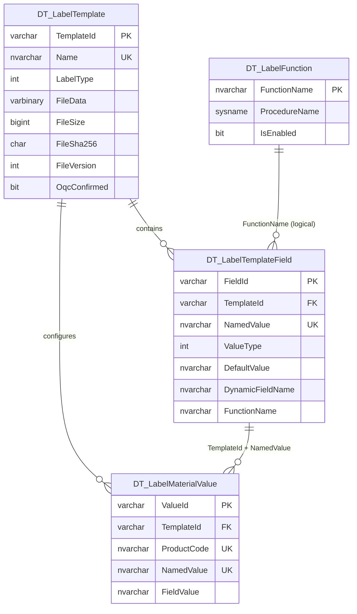

# DT 标签模板维护迁移（第一阶段）

> 正式 TXT 打印链路已在后续阶段实现，数据库/API/部署说明见 [dt-label-formal-printing.md](dt-label-formal-printing.md)。该后续迁移脚本仍未执行。

## 1. 实施结果

本阶段已在新 Learun 系统中落地标签模板维护闭环，页面采用“左侧模板、右侧详情”的结构。右侧包含“字段建模”和“料号参数”两个页签；预览只接收人工测试值，不调用旧出货函数，也不执行物理打印。

后端代码位于 `D:\com.delton.gz\Learun.Application.WebApi\Modules\WMS\DT_LabelTemplate`，前端代码位于 `D:\com.delton.gz\Learun.Application.Web\Areas\WMS\Views\DT_LabelTemplate`。

数据库脚本和样例迁移工具已提供，但本次没有连接业务数据库执行 DDL/DML。旧的空表 `WMS_LabelTemplate` 不在新模块的读写范围内。

## 2. 运行结构

```text
Learun MVC 页面
  -> DTLabelTemplateApi.js
  -> /api/wms-fg/label-templates
  -> Nancy LabelTemplateModule
  -> LabelTemplateService
  -> LabelTemplateRepository -> SQL Server DT_* 表
  -> BarTenderLabelEngine -> Seagull.BarTender.Print -> 临时 BTW/JPG
```

职责边界：

- Nancy Module：路由、multipart/DTO 绑定、响应转换。
- Service：文件安全、业务校验、字段类型校验、Excel 解析和流程编排。
- Repository：参数化 SQL、显式事务、锁和数据完整性复验。
- BarTender 适配器：BTW 打开、Named Data Sources 枚举、测试值注入、图片导出和资源释放。

## 3. 数据模型



`DT_LabelTemplateField` 与 `DT_LabelMaterialValue` 由模板外键级联删除。料号参数到字段采用 `(TemplateId, NamedValue)` 逻辑关联，并由 Repository 在写事务中校验；没有设置复合外键，以避免改变字段表现有键设计。

字段取值类型：

- `0 默认值`：使用 `DefaultValue`。
- `1 动态字段`：关联受控主数据字段名。
- `2 函数`：关联 `DT_LabelFunction.FunctionName`；函数目录显示存储过程是否存在。
- `3 手动输入`：由未来业务打印流程输入。

第一阶段图片预览不自动求值。页面为每个 BTW Named Value 提供测试值输入框，然后把字典直接传给 SDK。

## 4. BTW 生命周期

新增模板必须上传安全的 `.btw` 文件名，不能包含目录、相对路径或 Windows 非法字符，并受上传大小配置限制。服务从上传流读取二进制，通过 SDK 枚举 `LabelFormatDocument.SubStrings`，将结果写为字段模型。

替换已有 BTW 时在同一事务中完成：

1. 更新文件二进制、大小和 SHA-256；文件版本加一。
2. 同名 Named Value 保留原有建模配置，只更新排序。
3. 新 Named Value 初始化为“默认值”类型。
4. 删除 BTW 已移除的字段及其料号参数。
5. 取消 OQC 确认。

仅编辑模板元数据、字段模型或料号参数也会取消 OQC，避免确认状态覆盖后续变更。

## 5. API

统一前缀：`/api/wms-fg/label-templates`。Learun Web 的同源请求由现有 `api/wms-fg/{*path}` MVC 路由代理到 WebApi。

| 方法 | 路径 | 用途 |
|---|---|---|
| GET | `/` | 模板分页查询 |
| GET | `/{id}` | 模板详情 |
| POST | `/create` | multipart 新增模板 |
| POST | `/{id}/update` | multipart 编辑/替换 BTW |
| POST | `/{id}/delete` | 删除模板及新模块子数据 |
| GET | `/{id}/download` | 下载数据库 BTW |
| GET | `/{id}/fields` | 查询字段模型 |
| POST | `/{id}/fields/save` | 完整保存字段模型 |
| GET | `/functions` | 函数目录和过程可用状态 |
| GET | `/{id}/material-values` | 料号参数分页查询 |
| POST | `/{id}/material-values/save` | 单条 upsert |
| POST | `/material-values/{valueId}/delete` | 删除单条参数 |
| GET | `/material-values/import-template` | 下载 Excel 模板 |
| POST | `/{id}/material-values/import` | Excel 整批校验和事务 upsert |
| POST | `/{id}/preview` | 人工测试值图片预览 |
| POST | `/{id}/oqc/confirm` | OQC 确认 |
| POST | `/{id}/oqc/cancel` | 取消 OQC |
| GET | `/sdk-health` | SDK 程序集和引擎启动诊断 |

这些路由由 Nancy `BaseApi` 模块承载，写法与 WMS_FG 的 `HuModule`、`HuLocationModule` 一致：路由参数先读取为 `object`，再通过 `Convert.ToString` 转换；绑定 DTO 可直接传入 Service；普通 JSON 响应统一为 `ApiResult`：

```json
{
  "Code": 200,
  "Message": "success",
  "Data": {}
}
```

业务异常返回 `Code=400` 和具体 `Message`。BTW/Excel 下载成功时仍直接返回附件流；下载失败时返回同一 `ApiResult` 错误结构。

## 6. 页面行为

左侧提供模板类型/关键字查询、模板列表、文件版本与 OQC 状态，以及新增、编辑、删除、下载、预览和 OQC 操作。

右侧在未选择模板时显示引导空状态；选择后显示模板摘要：

- 字段建模：表内直接设置说明、取值类型、默认值、动态字段和函数。
- 料号参数：按料号/字段查询，支持增删改、下载 Excel 模板和导入。
- 预览弹窗：自动按当前字段生成测试输入，返回 Base64 JPEG。

## 7. BarTender SDK 部署要求

工程通过 `BarTenderSdkDir` 引用 `Seagull.BarTender.Print.dll`，没有把授权文件或 SDK DLL 复制进仓库。目标服务器须满足：

1. 安装并授权 64 位 BarTender 2022 R8，使用本项目已验证的 `Seagull.BarTender.Print 11.3.8.1`。
2. WebApi 使用 `.NET Framework 4.7.2` 和 x64 构建；IIS Express 必须使用 `C:\Program Files\IIS Express\iisexpress.exe`，正式 IIS 应用池必须设置 `Enable 32-Bit Applications=False`。
3. IIS 账号对临时目录具有创建、读取和删除权限。
4. BarTender Licensing/System/Print Scheduler 等必要服务正常。
5. BarTender System Database 可由运行账户正常访问。
6. 部署后先调用 `/sdk-health`，再用测试模板依次验证上传解析和图片导出。

配置位于 WebApi `XmlConfig/system.config`：

- `BarTenderSdkEnabled`
- `BarTenderTempDirectory`
- `BarTenderMaxUploadBytes`

MSBuild 属性 `BarTenderSdkDir` 默认指向 `C:\Program Files\Seagull\BarTender 2022\SDK\Assemblies`。构建机路径不同可传 `/p:BarTenderSdkDir=...`。工程包含构建门禁：目录中没有 `Seagull.BarTender.Print.dll` 时立即失败；运行时 health 只接受 `11.3.x` SDK，防止误加载其他主次版本。

SDK、WebApi 构建平台和 IIS 宿主必须统一为 x64。旧 `Pechkin 0.5.8.1` 为 x86 且没有活动源码调用，已从 WebApi 工程移除；如历史 PDF 功能回归发现仍依赖 Pechkin，必须改用 x64 组件或隔离为单独 32 位进程，不能重新放回承载 BarTender 的进程。

## 8. 数据库和样例工具

- `Sql/001_DT_LabelTemplate.sql`：可重复执行的建表脚本，带事务和 `XACT_ABORT`。
- `Sql/Import-LegacyLabelSamples.ps1`：默认 dry-run；只有显式 `-Apply` 才导入 `X02.btw`、`A25Suzhou.btw`、`G38.btw` 及关联字段、料号参数和函数目录。
- `Sql/003_ClearSampleTemplates.sql`：只清除新 `DT_*` 表内三个样例模板，子表由级联关系清理。

上线顺序：备份/快照确认 -> 人工审阅 SQL -> 执行建表脚本 -> 部署 WebApi 与 BarTender SDK -> `/sdk-health` -> 导入三个样例 -> 对账数量/SHA -> 浏览器验收 -> OQC。

## 9. 验证结果与未完成项

已完成：

- WebApi 已升级为 `.NET Framework 4.7.2`、x64 和 64 位 IIS Express，DT 标签源码、SQL 内容与 BarTender 2022 SDK 引用均已登记到经典 `.csproj`。
- 使用本机真实 BarTender 2022 R8 SDK `11.3.8.1` 完整编译 WebApi 成功。CorFlags 结果为 `PE32+`、`32BITREQ=0`、`32BITPREF=0`；构建输出不含 Pechkin，并包含 `System.ValueTuple 4.0.5.0` 和 `NPOI.OOXML 2.7.5.0`。
- Learun Web Debug Build 成功。
- 两个前端 JavaScript 文件通过 Node 语法检查。
- 建表 SQL 使用 SQL Server `SET PARSEONLY ON` 通过语法解析。
- 核心后端代码未发现 `dynamic`、`AddWithValue` 或 Nancy 参数直传 Service。
- 样例迁移 PowerShell 通过语法解析。

未完成/不能宣称通过：

- 未执行目标库建表、样例迁移、对账或回滚测试。
- 未做浏览器联调、Postman 或目标服务器 IIS 测试。
- 本机 64 位 SDK 引擎启动仍失败：COM 返回 `0x800706BA`，同时 Windows Application 日志持续记录 `MSSQL$BARTENDER 18456`，原因是当前账户无法打开 BarTender `Datastore`。需先在 BarTender Administration Console 修复 System Database 连接/权限，再重新执行 health、字段解析和图片导出。
- 未测试真实业务函数、真实出货求值或物理打印，这些均不属于第一阶段。

## 10. 推荐验收顺序

1. `GET /sdk-health`，确认程序集版本和 `EngineStarted=true`。
2. 新增 X02，确认解析出 10 个 Named Values。
3. 保存四种字段类型，确认修改后 OQC 自动取消。
4. 替换测试 BTW，核对同名保留、新增初始化、删除级联和版本递增。
5. 下载 BTW，比较数据库 SHA-256。
6. 以人工值预览三个模板，检查中文、条码、空值和特殊字符。
7. 手工和 Excel 维护料号参数，验证非法料号、非法字段、重复和整批回滚。
8. 并发触发解析/预览，确认请求串行且值不串模板。
9. 完成 OQC 确认/取消和常用分辨率页面检查。
